# Habit Grid (한국어)

> English documentation: [README.md](README.md).

Habit 기록을 GitHub 잔디 같은 격자로 노트 안에 보여줘요. 주간 보기, 연속 기록, 목표, 챌린지를 지원해요.

**애플 미리 알림 빠른 설정:** [iPhone 단축어](#iphone-단축어-연동-미리-알림) · [Mac 동기화](#선택-mac에서-자동으로-가져오기). 둘 중 **하나만** 고르세요(아래 참고).

## 애플 미리 알림을 위해 만들었지만, 없이도 쓸 수 있어요

Habit Grid는 **애플 미리 알림으로 습관을 기록하고 보관함에서 시각화**하려고 만들었어요. iPhone에서 미리 알림을 완료하면 iOS 단축어가 그 기록을 마크다운 파일에 덧붙이고, 대시보드에 바로 보여요. [iPhone 단축어 연동](#iphone-단축어-연동-미리-알림)을 보세요. Mac이 있다면 [Mac 동기화](#선택-mac에서-자동으로-가져오기)를 쓸 수도 있어요.

미리 알림이 없어도 괜찮아요. 모든 기록이 평범한 마크다운 파일이라서 이렇게도 쓸 수 있어요.

- 플러그인에서 습관을 만들고 칸을 눌러 기록해요.
- 기록 줄을 직접 적어요.
- 다른 단축어나 스크립트 같은 도구로 줄을 덧붙여요.

플러그인은 보관함의 마크다운 파일만 읽고 쓰고, 네트워크를 쓰거나 데이터를 밖으로 보내지 않아요. 애플과는 관련이 없어요.

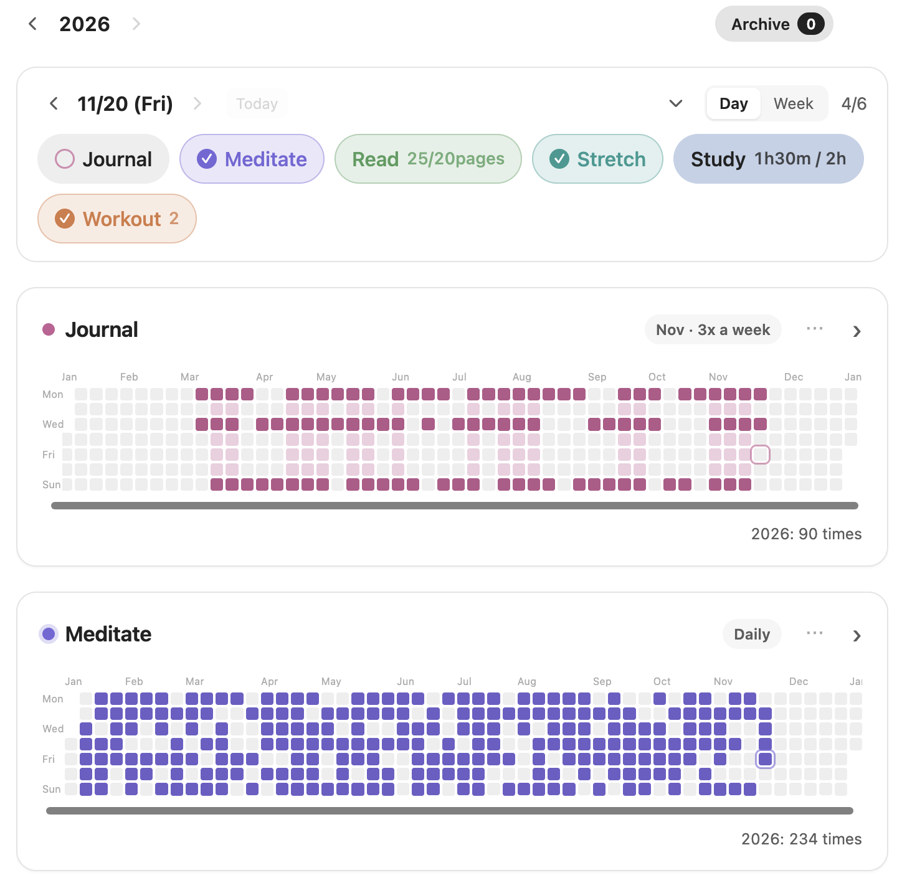

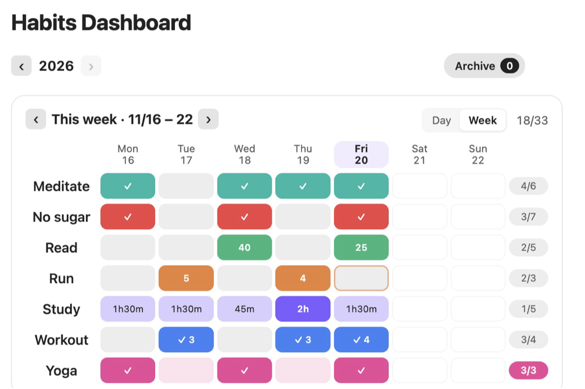

## 기능

- **애플 미리 알림 기록 (선택)** – iOS 단축어로 완료한 미리 알림을 마크다운 로그 파일에서 읽어요.
- **대시보드** – `habit` 코드 블록(과 미리 만들어 둔 "Habits Dashboard" 노트)이 습관마다 카드 한 장과 1년 또는 6개월 격자를 보여줘요.
- **세 가지 습관 종류**
  - *단순 체크* – 했는지 안 했는지만 기록해요.
  - *양 기록* – 시간, 분, 쪽, km, 또는 직접 적은 단위(예: "공부 2시간").
  - *항목 기록* – 한 습관 아래에 이름 붙은 항목을 남겨요(예: 운동 → 스쿼트, 플랭크). [항목 습관](#항목-습관)을 보세요.
- **챌린지** – 습관에 기간(30 / 66 / 100일 또는 직접 입력)을 주면 진행도, 연속 기록, "완료" 배너가 있는 챌린지 카드가 돼요. 기간이 없으면 일반 카드예요. 챌린지도 주간 목표를 채우면 그 주의 남은 칸이 일반 카드처럼 연하게 표시돼요. 주 몇 회 할지는 카드의 기간 칩 메뉴에서 정할 수 있어요.

  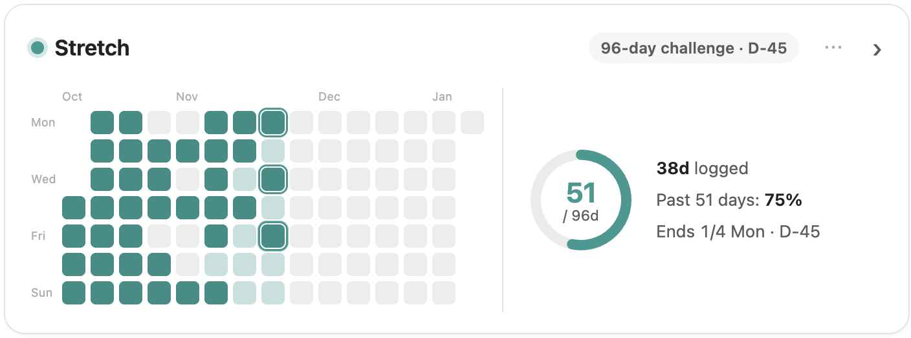
- **반복 규칙** – "주 N회" 또는 "요일 지정"(월, 수, 금…). 달마다 규칙을 다르게 정할 수 있고, 비워 둔 달은 앞 달의 규칙을 이어 써요.

  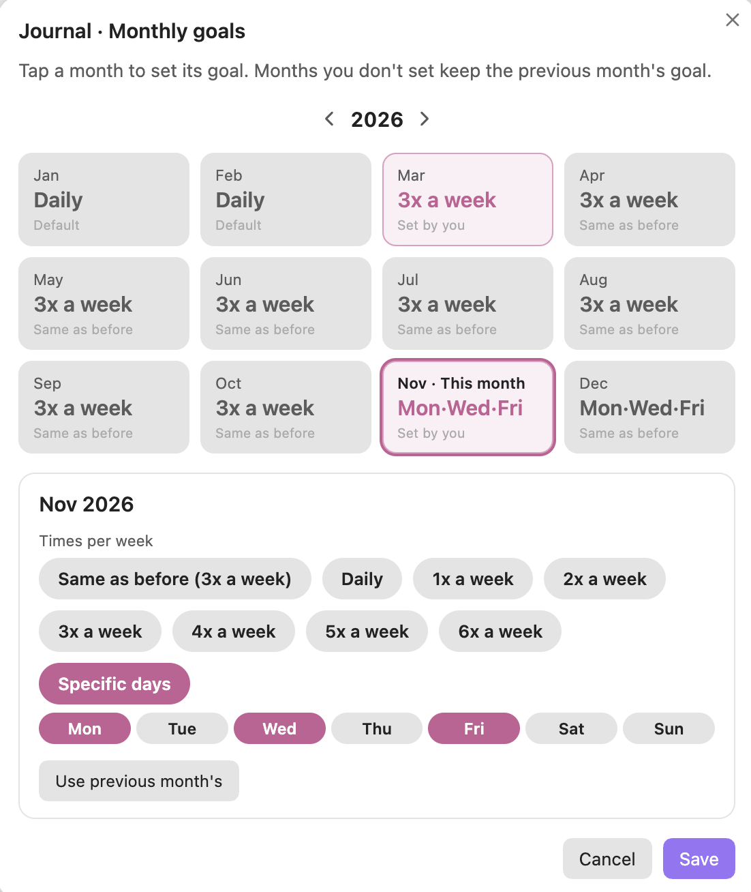
- **목표** – 양 습관의 월별 하루 목표량(예: 하루 20페이지)과, 목표를 채운 주가 몇 번인지 보여주는 통계.

  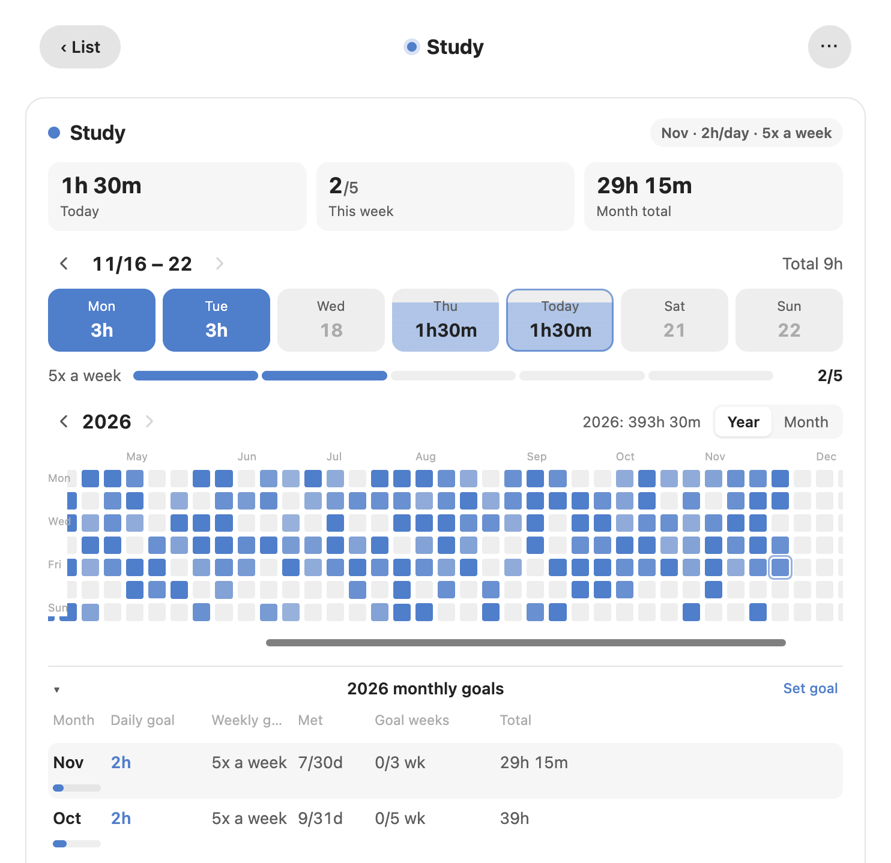

  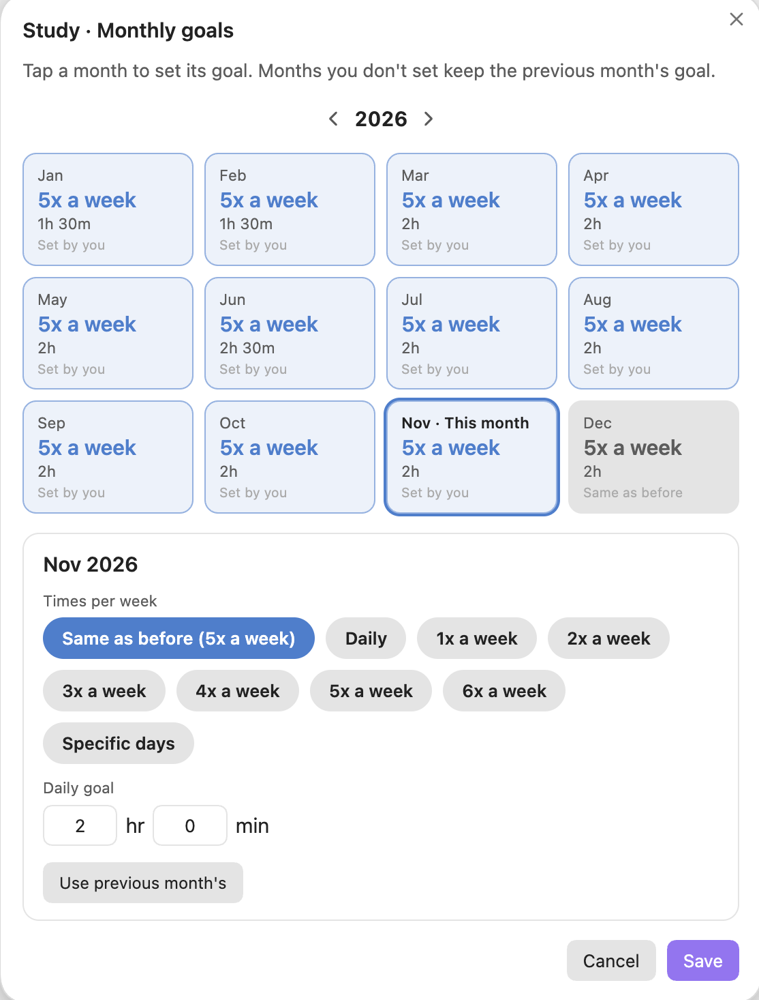
- **눌러서 고치기** – 칸을 눌러 기록을 더하거나 지우고, 지난 날은 기록 창에서 채워요.
- **오늘 줄** – 대시보드 맨 위가 오늘 할 일을 보여줘요. *일간*(옆으로 넘기는 최근 14일)과 *주간*(습관마다 한 줄, 요일마다 한 칸. 칸을 눌러 그 날을 기록하고, 이전 주로 넘겨 볼 수 있어요) 중에서 골라요. 각 줄 끝에는 한 주의 달성/목표가 나오고, 정해 둔 주 횟수나 요일을 기준으로 해요(정하지 않았다면 매일). 목표를 채우면 남은 날은 습관 색의 연한 톤으로 바뀌어요. 고른 보기는 기억해요. `▾` 버튼으로 줄을 머리글만 남기고 접을 수 있고, 접은 상태도 기억해요.
- **보관함** – 끝낸 습관은 보관함 폴더로 옮겨요. 기록은 남아 있고 다시 꺼낼 수 있어요.
- **언어** – 영어, 한국어, 자동(앱 언어를 따라가요).
- **데이터는 노트 안에** – 데이터베이스도, 네트워크 접속도 없어요.

## 설치

### 커뮤니티 플러그인에서

1. **설정 → 커뮤니티 플러그인 → 둘러보기**를 열어요.
2. "Habit Grid"를 검색해 설치하고 켜요.

### 직접 설치

1. [최신 릴리스](../../releases/latest)에서 `main.js`, `manifest.json`, `styles.css`를 받아요.
2. `<보관함>/.obsidian/plugins/habit-grid/`에 복사해요.
3. 앱을 다시 불러오고 **설정 → 커뮤니티 플러그인**에서 **Habit Grid**를 켜요.

처음 켜면 `habit-grid` 폴더, `Habits Dashboard` 노트, `sync/Reminders log.md`를 만들어요. `list/`와 `archive/` 폴더는 첫 습관을 만들거나 보관할 때 생겨요. 명령 팔레트에서 **습관 폴더와 대시보드 만들기**를 실행해도 돼요.

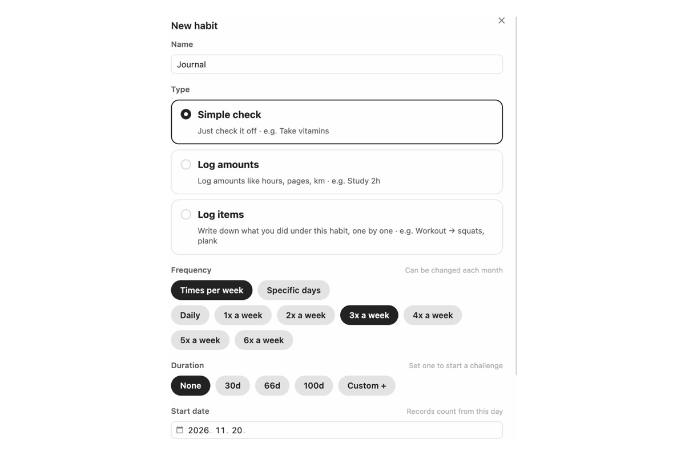

## 명령

| 명령 | 하는 일 |
| --- | --- |
| 습관 대시보드 열기 | 대시보드 노트를 열어요(리본 아이콘도 있어요) |
| 일간·주간 기록 코드 넣기 | 커서 위치에 `view: today`가 든 `habit` 블록을 넣어요 |
| 습관 폴더와 대시보드 만들기 | 없으면 폴더와 노트를 만들어요 |
| 새 습관 만들기 | 새 습관 만들기 창을 열어요 |
| 습관 기록하기 (날짜 골라서) | 기록 창을 열어요(리본 아이콘도 있어요) |

## 폴더 구조

모든 것이 폴더 하나(기본 `habit-grid`) 아래에 있어요.

```
habit-grid/
├── Habits Dashboard.md      대시보드 노트
├── list/                    습관마다 파일 하나, 예: 공부.md (설정과 모든 기록)
├── sync/                    미리 알림 받은편지함: Reminders log.md
└── archive/                 보관한 습관 파일
```

이 세 하위 폴더만 읽어요. `habit-grid/`에 바로 놓은 파일(대시보드 제외)은 무시해요.

**기록이 있는 곳.** `list/`의 습관 파일 하나가 그 습관의 설정과 모든 기록을 담아요. `sync/Reminders log.md`는 단축어나 Mac 스크립트 같은 도구가 덧붙이는 받은편지함일 뿐이에요. 새 줄이 들어오면 플러그인이 습관 파일로 옮기고, 처음 보는 습관이면 파일을 만들어요. 기록을 지우려면 앱에서 지우세요(칸을 누르거나 *이날 기록 지우기*). 플러그인이 `- [ ] 날짜` 표시를 남겨서 그 날을 다시 가져오지 않아요. 대신 파일에서 손으로 줄을 지우면 이후 미리 알림 줄이 그 날을 다시 살릴 수 있어요.

### 습관 파일

습관 파일은 `habit-grid/list/`에 있는 마크다운 노트예요. 파일 이름이 습관 이름이고, 설정은 프론트매터에, 직접 적은 기록은 본문 줄에 있어요.

모든 속성에는 한국어 이름과 영어 이름이 있고, 둘 다 읽어요. 새로 적을 때는 파일이 이미 쓰는 이름을 따르고, 처음이면 설정의 *속성 이름*에서 고른 쪽으로 적어요.

| 한국어 | 영어 | 뜻 |
| --- | --- | --- |
| `단위` | `unit` | 양 습관의 단위: `시간`, `분`, `쪽`, `km` 또는 아무 글자(영어 `hours`, `minutes`, `pages`도 돼요) |
| `월별목표` | `monthGoals` | 달마다 하루 목표: `"2026-11": 2` |
| `월별횟수` | `weeklyTimes` | 달마다 주 몇 회: `"2026-11": 3` |
| `월별요일` | `weekdays` | 달마다 특정 요일, `0` = 일요일 … `6` = 토요일: `"2026-11": [1, 3, 5]` |
| `기간` | `duration` | 챌린지 일수 |
| `시작` | `start` | 시작일, `YYYY-MM-DD`. 습관을 만들 때 정해져요. 주간 보기는 이 날부터 습관을 보여주고 챌린지도 이 날부터 세요. 없으면 첫 기록이 시작이에요 |
| `보관` | `archived` | 보관했으면 `true` |
| `항목` | `items` | `true`면 그 습관의 항목 기록을 켜요([항목 습관](#항목-습관) 참고) |
| `숨긴항목` | `hiddenItems` | 항목 습관의 추천에서 뺀 항목(지난 기록은 그대로) |
| `색` | `color` | 카드 색, 예: `"#3b82f6"` |

예시:

```markdown
---
단위: 시간
월별목표:
  "2026-11": 2
월별횟수:
  "2026-11": 5
색: "#3b82f6"
---
- [x] 2026-11-18 1시간30분
- [x] 2026-11-19 2시간
```

플러그인 메뉴를 쓰면 이 속성들을 플러그인이 직접 적어요.

### 기록 줄

한 줄에 기록 하나예요.

```
- [x] 2026-11-19 스트레칭
```

체크한 할 일, 날짜(`YYYY-MM-DD`), 미리 알림 제목이에요. 규칙은 이래요.

- 똑같은 줄(같은 날짜, 같은 제목)은 한 번만 세요.
- 습관 파일 안의 체크하지 않은 줄 `- [ ] YYYY-MM-DD`는 가져온 날을 지웠다는 표시예요.
- 양 습관 파일에서는 날짜 뒤에 양을 적을 수 있어요: `- [x] 2026-11-18 1시간30분`. 항목 습관 파일에서는 항목을 나열해요: `- [x] 2026-11-20 스쿼트 30회, 플랭크`.

#### 미리 알림 제목은 이렇게 읽어요

| 미리 알림 제목 | 결과 |
| --- | --- |
| `명상` | *명상*이라는 단순 체크 습관 |
| `공부 2시간`, `공부 1시간 30분`, `공부 45분` | 습관 *공부*의 시간(`시간`, `분`과 영어 `h`, `hr`, `hours`, `m`, `min`, `minutes`를 읽어요) |
| `독서 20쪽` | *독서* 20쪽(`쪽`, `페이지`, 영어 `pages`) |
| `달리기 5km` | *달리기* 5 km |
| `운동 스쿼트 30회` | 항목 습관 *운동* 아래의 항목 *스쿼트*, *30회* |
| `운동 1시간` | 항목 습관 *운동*의 그 날만 한 날로 세요. 이름 바로 뒤의 양은 항목이 아니라서 남기지 않아요 |

제목은 습관 이름과 제목의 앞부분을 맞춰 보고, 대소문자를 구분해요.

**양 습관(시간·쪽·km).** 플러그인에서 *새 습관* → *양 기록*으로 만들고 칸을 눌러 양을 입력하거나, 미리 알림 제목에 양을 적어요: `공부 2시간`, `공부 2시간 30분`, `독서 20쪽`. 제목으로 만든 습관은 자동으로 생겨요. 미리 알림 제목은 저절로 바뀌지 않아서, 날마다 양이 다르면 칸을 눌러 입력하는 편이 쉬워요. 항상 같은 형식으로 쓰세요. 어떤 날은 `공부`, 어떤 날은 `공부 2시간`이면 양이 없는 날은 보이지 않아요. 같은 날 양이 있는 제목이 둘이면 큰 값을 써요.

**함께 묶일 미리 알림 이름 짓기.** 항목 기록을 켠 습관(예: *스트레칭*, *운동*)은 그 이름으로 시작하는 제목이 그 습관의 항목이 돼요. 습관 이름을 앞에, 부위를 뒤에 써요: `스트레칭 목`, `운동 하체`. 항목 기록을 켜지 않은 습관이거나 따로 하나의 습관으로 두고 싶으면 순서를 바꿔 `목 스트레칭`처럼 써요.

## 항목 습관

항목 습관은 운동 → 스쿼트, 플랭크처럼 습관 아래에 한 일을 남기는 습관이에요. 한 습관은 항목 습관이거나 양 습관(시간, 쪽, km)이고 둘 다는 아니에요. 단위가 있는 습관에서는 항목 기록을 쓸 수 없어요.

- **켜는 법**: 습관을 만들 때 *항목 기록* 종류를 고르거나, 습관 `⋯` 메뉴에서 **항목 기록 켜기**를 고르거나, 습관 파일에 `항목: true`를 적어요. 켜면 그 습관 이름으로 시작하는 미리 알림 제목(`운동 스쿼트`)이 그 습관의 항목이 돼요. 켜지 않으면 `운동 스쿼트`는 그냥 다른 습관이에요.
- **기록하는 법**: 날을 눌러 체크해요. 체크한 날을 다시 누르면 한 일을 고르거나 새 항목을 더해요. 아무것도 고르지 않아도 그 날은 기록돼요. 항목마다 `30회` 같은 양을 적을 수 있고, 양 칸은 마지막에 쓴 값을 추천해요.
- **추천**은 최근 두 달 안에 쓴 항목을 보여줘요. 추천 옆의 `×`는 확인한 뒤 목록에서 빼요. 지난 기록은 남고, 그 항목을 다시 기록하면 돌아와요.
- **하루 지우기**: 창의 *이날 기록 지우기*예요.

항목은 습관 파일의 그 날 줄에 저장돼서 직접 고칠 수도 있어요.

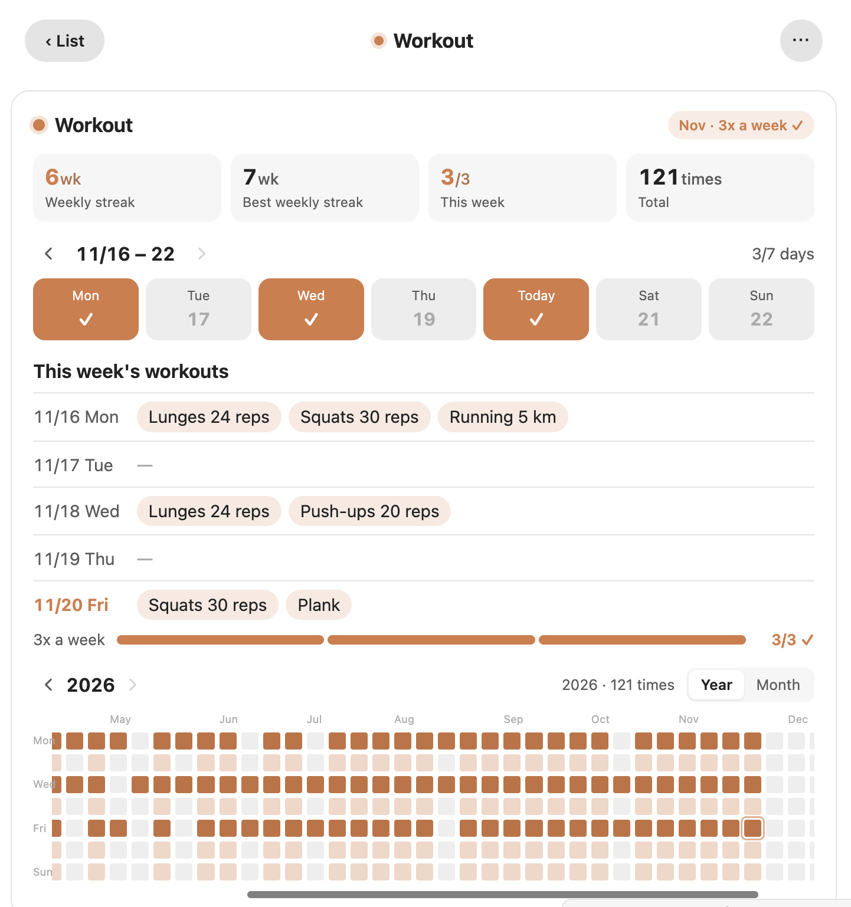

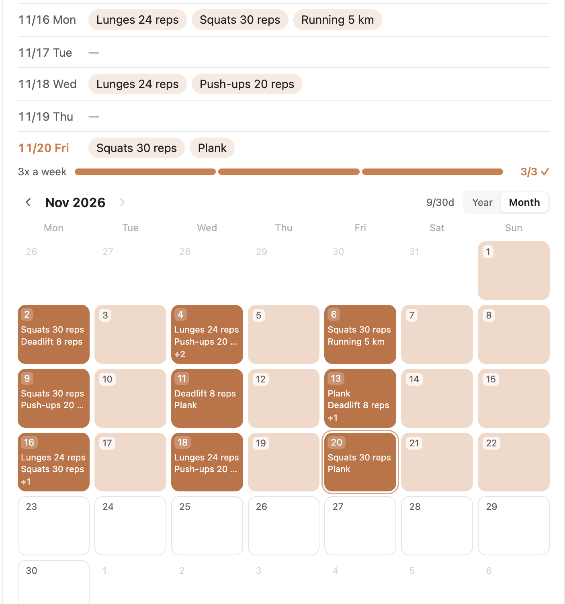

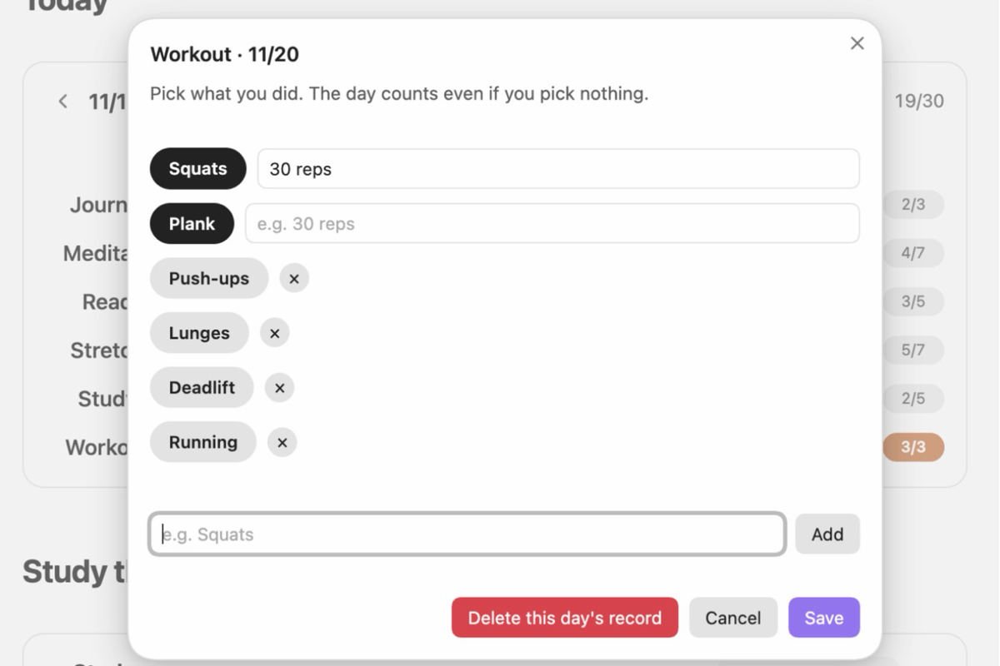

## iPhone 단축어 연동 (미리 알림)

> **이 단축어와 [Mac 동기화](#선택-mac에서-자동으로-가져오기) 중 하나만 쓰세요.** 둘 다 켜도 같은 줄은 한 번만 세지만, 한 가지만 쓰는 편이 단순하고 문제가 생겼을 때 찾기 쉬워요.

미리 알림 앱의 완료 기록은 iOS 단축어로 모을 수 있어요. 단축어가 `Habits`라는 목록에서 완료한 미리 알림을 `sync/Reminders log.md`에 덧붙여요.

### 빠른 설치: 공유된 단축어 내려받기

1. iPhone, iPad, Mac에서 단축어를 내려받아 추가해요: **[Reminders to Habit Grid](https://www.icloud.com/shortcuts/8e5699174e95444996780e637ebdce18)**. iOS가 거부하면 **설정 → 단축어**에서 **신뢰할 수 없는 단축어 허용**을 켜세요.
2. 나머지는 이미 만들어져 있어요. 아래 두 가지만 직접 고르면 돼요. 사용자마다 다른 값이라 단축어를 공유할 때 같이 넘어가지 않아요.
   - **미리 알림 목록:** **미리 알림 찾기**에서 **목록 다음과 같음** 뒤에, 습관을 기록할 목록을 골라요(예: `Habits`).
   - **파일 경로:** **파일에 덧붙이기** 동작 **두 개 모두**(마감일이 있는 미리 알림용과 *그렇지 않은 경우*의 것)에서 폴더를 내 보관함의 **`habit-grid/sync`** 폴더로 정하고, 파일 이름은 `Reminders log.md` 그대로 두세요. 파일 선택 화면에서 보관함은 *iCloud Drive → Obsidian* 또는 *나의 iPhone → Obsidian* 아래에 있어요.
3. 한 번 실행하고 `Reminders log.md`를 열어 보세요. 미리 알림 하나가 한 줄로, `- [x] 2026-11-19 명상`처럼 보이면 돼요.
4. 원하는 대로 정하세요.
   - **동기화 시간:** 단축어 앱의 **자동화 → 개인용 자동화 → 하루 중 시간**에서 시각을 정해요(예: 매일 밤 11시 55분). **즉시 실행**을 켜면 확인 창이 뜨지 않아요. 시각이 다른 자동화를 여러 개 만들거나 Obsidian을 열 때 실행하게 할 수도 있어요. "N분마다" 반복은 안 돼요. 그럴 땐 [Mac 동기화](#선택-mac에서-자동으로-가져오기)를 쓰세요.
   - **며칠치를 읽을지:** **미리 알림 찾기**의 *완료일이 최근 3일 이내*에서 일수를 원하는 만큼 바꿔요. 숫자가 크면 늦게 완료한 것도 잡히지만 로그가 더 빨리 길어져요(아래 **로그 정리** 참고).

로그에는 같은 줄이 여러 번 모일 수 있어요. 단축어가 돌 때마다 최근 3일을 다시 읽기 때문이에요. 괜찮아요. 습관에는 하루에 한 번만 기록돼요. 중복 줄이 거슬리면 플러그인 설정의 **로그 정리**를 눌러 지울 수 있어요.

단축어에서 고르는 폴더는 사용자 각자의 것이라 단축어를 공유할 때 같이 넘어가지 않아요. 빈 칸이거나 다른 곳을 가리키고 있으면 직접 고르세요.

### 직접 만들기

같은 동작으로 직접 만들 수도 있어요. 순서대로 만들어요.

1. **미리 알림 찾기** – 목록 = `Habits`, 완료됨 = 예, 완료일이 최근 3일 이내.
2. 1번의 항목에 **각 항목 반복**.
3. 반복 안에서 **조건문**: 미리 알림의 **마감일**이 **값을 가지고 있음**인 경우:
   - `habit-grid/sync/Reminders log.md`에 **파일에 덧붙이기** – 문장은 `- [x] ` + **마감일** + 공백 + **반복 항목**(제목)이고, **새로운 줄 만들기**를 켜요. 마감일의 날짜 형식을 **사용자 지정** `yyyy-MM-dd`로 정해요(마감일 변수를 눌러 바꿔요).
4. **그렇지 않은 경우**:
   - 같은 파일, 같은 설정으로 **파일에 덧붙이기** – 문장은 `- [x] ` + **완료일** + 공백 + **반복 항목**이에요. 완료일의 형식도 **사용자 지정** `yyyy-MM-dd`로 정해요. 그다음 **조건문 종료**와 **반복 종료**를 해요.

단축어 이름은 마음대로 지어도 돼요. 예를 들면 *Habit Grid 기록*이에요.

**제목에는 *미리 알림*(미리 알림 찾기가 돌려준 목록 전체)이 아니라 *반복 항목* 변수를 쓰세요.** 목록을 쓰면 줄마다 모든 제목이 붙어서 기록이 엉뚱한 습관에 들어가요. 제대로 된 로그는 미리 알림 하나가 한 줄이에요.

```
- [x] 2026-11-19 명상
- [x] 2026-11-20 공부 2시간
```

각 미리 알림은 **마감일** 날짜로 기록돼요. 그래서 어제 것을 자정이 지난 뒤 체크해도 어제로 세요. 마감일이 없는 미리 알림은 완료한 날로 기록하고, 마감일보다 먼저 완료하면 마감일 날짜로 기록돼요.

직접 돌리거나 개인 자동화로 돌려요. 예를 들어 매일 밤 11시 55분이에요. 최근 3일을 읽기 때문에 늦게 완료한 미리 알림도 잡혀요.

다시 읽기 때문에 단축어는 돌 때마다 같은 줄을 또 덧붙여요. 습관 기록에는 중복이 생기지 않지만(하루는 한 번만 세요) 로그 파일은 계속 길어져요. 설정의 **로그 정리**를 가끔 눌러 중복 줄을 지우세요. 제목을 어떻게 읽는지는 위의 *미리 알림 제목은 이렇게 읽어요*를 보세요.

플러그인은 로그 파일을 이름으로 알아봐요. 기본은 `Reminders log`이고 설정에서 다른 이름으로 바꿀 수 있어요. 처음 설정할 때 플러그인이 `habit-grid/sync/`와 단축어가 덧붙일 빈 `Reminders log.md`를 만들어요.

## 선택: Mac에서 자동으로 가져오기

> **이 방법과 [iPhone 단축어](#iphone-단축어-연동-미리-알림) 중 하나만 쓰세요.** 둘 다 켜도 같은 줄은 한 번만 세지만, 한 가지만 쓰는 편이 단순하고 문제가 생겼을 때 찾기 쉬워요.

Mac이 있다면 단축어 대신 작은 스크립트가 완료한 미리 알림을 로그 파일에 덧붙일 수 있어요. 어느 기기에서 완료하든 iCloud로 Mac에 도착하면 스크립트가 덧붙여요. Mac이 꺼져 있었다면 켜진 뒤 다음 실행 때 따라잡아요(최근 30일을 읽어요).

각 미리 알림은 단축어와 똑같이 **마감일** 날짜로 기록하고, 마감일이 없으면 완료한 날로 기록해요. 어제 것을 자정 넘어 체크해도 어제로 세요.

고급 방법이에요. 터미널에 명령을 한 번 붙여 넣어야 해요. 부담스러우면 칸을 눌러 기록하거나 단축어를 쓰세요.

### 3단계로 설치 (macOS 전용)

1. 옵시디언 **설정 → Habit Grid → Mac 동기화**에서 **설치 파일 만들기**를 누른 뒤, 아래에 나온 명령을 눌러 전체를 선택하고 Cmd+C로 복사해요.
2. 터미널을 열어요(`⌘ Space`를 누르고 `터미널`을 입력해 Return). `⌘ V`로 명령을 붙여 넣고 Return을 눌러요. macOS가 미리 알림 접근을 물어보면 허용하세요.
3. 설정으로 돌아와 **Mac 동기화 사용**을 켜요. 기본은 꺼짐이라 켜기 전에는 아무것도 하지 않아요.

이게 전부예요. 기본 목록은 `Habits`이고, 그 목록에서 새로 완료한 미리 알림은 아래에서 고른 간격 안에 들어와요.

### Mac 동기화 옵션

| 설정 | 하는 일 |
| --- | --- |
| 동기화할 미리 알림 목록 | 읽을 목록이에요. 기본 `Habits`, 여러 개는 쉼표로, 미리 알림 앱의 이름과 똑같이 적어요 |
| 가져올 기간 (일) | 한 번에 최근 며칠 치를 읽을지(기본 30일). Mac을 자주 꺼 두면 늘리세요 |
| 동기화 간격 | 얼마나 자주 가져올지: 5분~2시간(기본 30분) |
| 지금 동기화 | 로그에 이미 있는 내용을 바로 가져오고, 스크립트에 다음 확인 때(5분 이내) 실행하라고 요청해요 |

### 설치하면 일어나는 일

스크립트를 `~/.habit-grid-sync/`에 복사하고, 로그인할 때 실행되고 5분마다 깨어나는 백그라운드 작업을 등록해요. 스크립트는 고른 간격이 지났을 때만 실제로 가져와요. 아무것도 내려받지 않아요. 볼트의 `habit-grid/mac-sync/` 폴더 파일은 설치와 제거에만 쓰여요(옵시디언 파일 목록에는 `.sh` 파일이 안 보이니 Finder나 **Finder에서 보기** 버튼을 쓰세요). 플러그인 없이 설치하고 싶으면 이 저장소의 `scripts/` 폴더에 같은 파일이 있어요.

스크립트는 미리 알림을 읽기만 하고 로그 파일에 줄을 덧붙이기만 해요. 이미 있는 줄은 건너뛰어서 단축어와 달리 중복 줄을 만들지 않아요.

### 지우기

**플러그인을 지우기 전에** 먼저 하세요. **설정 → Habit Grid → Mac 동기화**에서 거기에 나온 지우는 명령을 눌러 전체를 선택하고 Cmd+C로 복사한 뒤 터미널에 붙여 넣어 Return을 눌러요. (플러그인만 지우면 Mac의 백그라운드 작업이 남아요. 플러그인이 없으면 아무것도 하지 않지만 5분마다 계속 깨어나요.)

이미 플러그인을 지웠다면 아래 두 줄을 터미널에 붙여 넣으세요.

```bash
launchctl bootout "gui/$(id -u)/md.habitgrid.sync"
rm -rf ~/Library/LaunchAgents/md.habitgrid.sync.plist ~/.habit-grid-sync
```

## 대시보드 코드 블록

````
```habit
```
````

블록 안에 더할 수 있는 줄: `habit: 공부, 운동`(이 습관만), `year: this`(아래 참고), `weeks: 20`, `color: #3b82f6`, `folder: habit-grid`. 한국어 이름(`습관`, `연도`, `주`, `색`, `폴더`)도 읽어요.

### 노트에 일간·주간 기록 넣기

일간이나 주간 기록을 홈 노트 같은 곳 어디든 넣어요. 원하는 코드를 골라 붙여 넣으세요.

| 코드 | 보여주는 것 |
| --- | --- |
| `view: today` | 일간과 주간을 *일간 / 주간* 전환 버튼과 함께(고른 쪽은 기억하고 대시보드와 같이 써요) |
| `view: day` | 일간만 |
| `view: week` | 주간만 |

````
```habit
view: day
```
````

`day`를 `week`나 `today`로 바꾸면 다른 보기가 돼요. `habit: 공부, 운동`을 더하면 일부 습관만 보여줘요. 명령 **일간·주간 기록 코드 넣기**가 커서 위치에 `view: today` 블록을 넣어 줘요. 칸을 누르는 방법은 대시보드와 같아서 노트에서 바로 기록할 수 있어요. 각 보기에는 이전 날이나 주로 넘겨 본 뒤 돌아오는 **오늘** / **이번 주** 버튼이 있어요.

`view: day`:

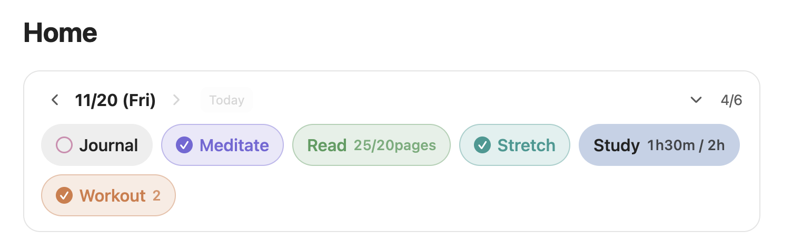

`view: week`:

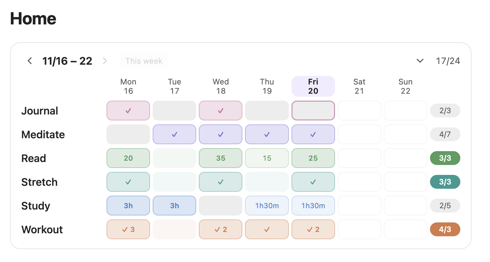

### 노트에 습관 하나의 한 해 넣기

습관 이름과 연도를 적으면 대시보드 카드처럼 그 습관의 연간 격자를 노트에 보여줘요. 카드를 누르면 자세히 볼 수 있어요.

````
```habit
habit: 공부
year: this
```
````

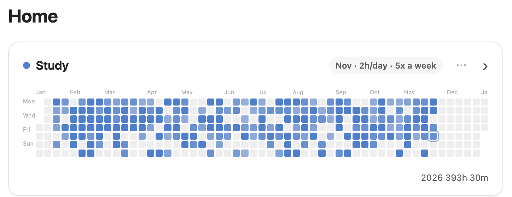

| `year:` | 보여주는 것 |
| --- | --- |
| `this` (또는 `올해`) | 올해. 해가 바뀌면 저절로 넘어가서 노트를 고칠 필요가 없어요 |
| `2025` | 그 해로 고정 |
| (생략) | 올해 (`weeks:`를 적었다면 최근 그 주 수만큼) |

해를 넘기는 버튼은 자세히 보기 화면에 있어요.

## 공개 사항

- **네트워크를 쓰지 않아요.** 네트워크 요청, 텔레메트리, 광고가 없어요.
- **파일은 볼트 안에서만** 읽고 써요. 마크다운 파일만 다루고, *설치 파일 만들기*를 눌렀을 때만 스크립트 파일 두 개를 볼트에 만들어요.
- **선택 사항인 Mac 스크립트**: 설치하기로 하면 옵시디언 밖에서 Mac에서 돌며 미리 알림 목록을 읽고 볼트 안의 로그 파일에 줄을 덧붙여요. 플러그인은 이 스크립트를 실행하지 않아요. 사용자가 직접 시작해요.

## 설정

| 설정 | 설명 |
| --- | --- |
| 언어 | 자동(앱 언어를 따라가요), 한국어, 영어 |
| 속성 이름 | 습관 파일에 적는 이름: 자동, 한국어, 영어. 이미 있는 속성은 이름을 유지해요 |
| 미리 알림 기록 파일 이름 | 단축어가 덧붙이는 로그 파일의 이름(기본 `Reminders log`) |
| 습관 폴더 | 습관 파일이 있는 폴더 |
| 대시보드 노트 이름 | 대시보드 노트의 이름. "지금 만들기" 버튼이 있어요 |
| 메인 화면 격자 | 한 쪽에 1년 또는 6개월 |
| 한 주의 시작 | 월요일 또는 일요일 |
| 칸 색깔 | 격자 색. 비워 두면 테마 강조색을 써요 |
| 칸을 눌러 기록 고치기 | 끄면 격자가 읽기 전용이 돼요 |
| 로그 정리 | 미리 알림 로그의 중복 줄을 지워요. 습관 기록은 바뀌지 않아요 |
| Mac 동기화 | 선택 사항인 Mac 스크립트 설정: 사용 여부(기본 꺼짐), 읽을 목록, 가져올 기간, 간격, 지금 동기화, 설치와 지우는 명령. [Mac 동기화](#선택-mac에서-자동으로-가져오기)를 보세요 |

설정을 바꾼 뒤에는 노트를 다시 열면 반영돼요.

## 알려진 제한

- 미리 알림 제목에서는 단위 `시간`, `분`, `쪽`, `페이지`, `km`와 영어 `h`/`hours`, `m`/`min`/`minutes`, `pages`를 읽어요. 그 밖의 단위는 제목에서 읽지 못해요. 양 습관의 파일에 단위를 적어 쓰세요.
- 항목 이름에는 쉼표를 쓸 수 없어요.
- 항목 창은 일간·주간 보기에서 열려요. 연간 격자 카드에서는 열리지 않아요.
- 양 습관에는 아직 챌린지 기간을 줄 수 없어요.
- 미리 알림 → 마크다운 방향만 지원해요. 미리 알림을 고쳐도 이미 쌓인 기록은 바뀌지 않아요.
- 날짜는 기기의 현지 시간대로 세요.
- 습관을 보관하거나 다시 꺼내면 플러그인이 그 습관 파일을 `list`와 `archive` 사이에서 옮겨요.

## 개발

소스는 `src/`에 있고 esbuild로 `main.js`에 묶여요. `main.js`가 아니라 `src/`를 고치세요.

```bash
npm install
npm run dev     # 저장할 때마다 main.js를 다시 빌드해요(Hot Reload 플러그인과 같이 써요)
npm run build   # 한 번 만드는 프로덕션 빌드
npm run lint    # eslint
npm test        # 순수 로직의 node 테스트
```

## 라이선스

[MIT](LICENSE)
