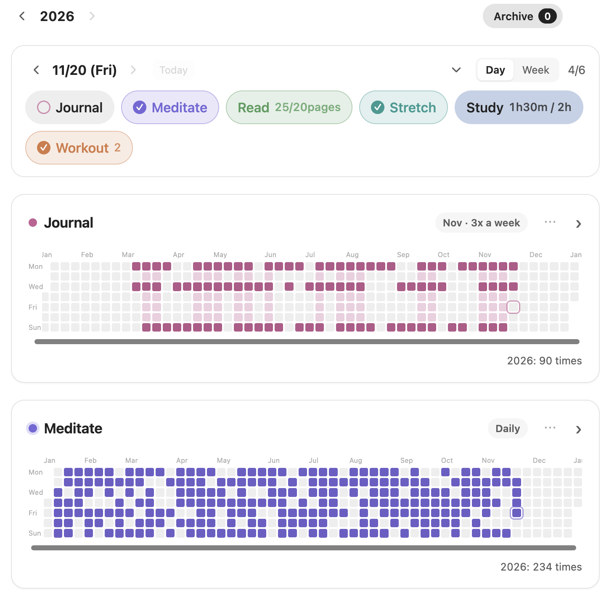
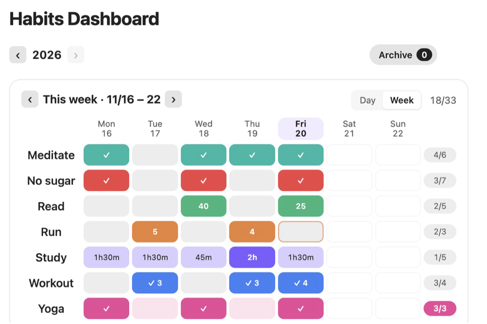
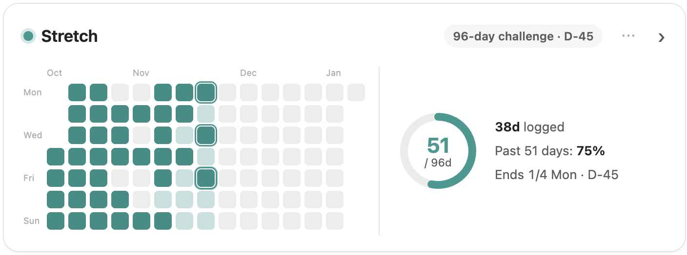
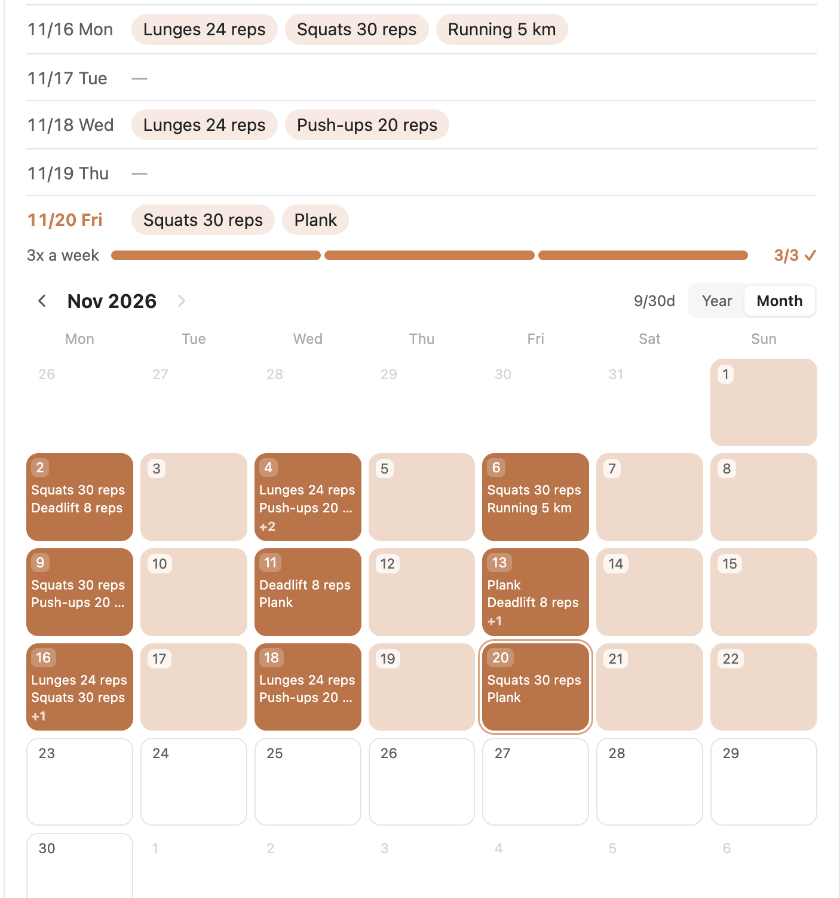
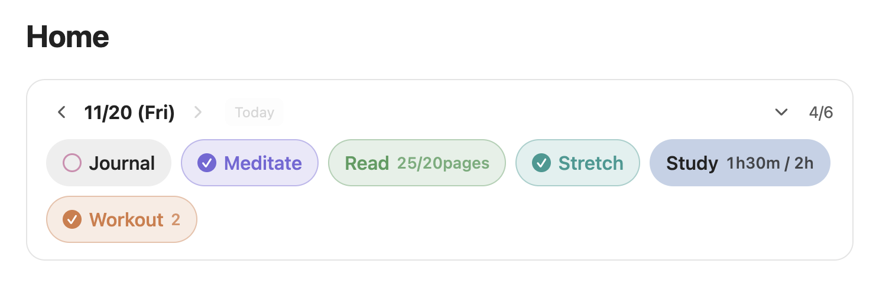
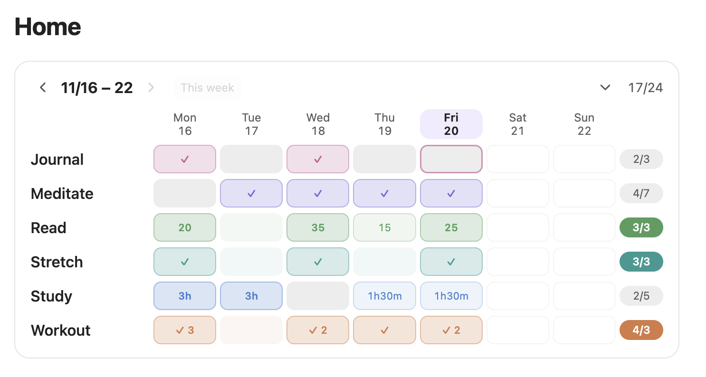
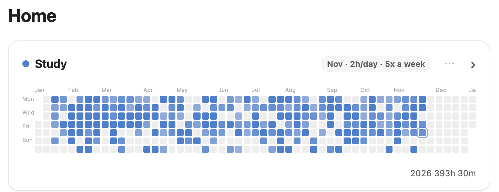

# Habit Grid

Turn habit records into a GitHub-style contribution grid inside your notes, with a week view, streaks, goals, and challenges.

> A Korean version of this document is [below](#한국어).

**Quick setup for Apple Reminders:** [iPhone Shortcut](#iphone-shortcuts-integration-reminders) · [Mac sync](#optional-sync-from-a-mac). Pick **one** of the two (see below).

## Made for Apple Reminders, usable without it

Habit Grid was built to **log habits with Apple Reminders and visualize them in your vault**. Complete a reminder on your iPhone, let an iOS Shortcut append it to a Markdown file, and the dashboard shows it. See [iPhone Shortcuts integration](#iphone-shortcuts-integration-reminders) or, on a Mac, [Mac sync](#optional-sync-from-a-mac).

You don't need Reminders, though. Everything is stored in plain Markdown files, so you can also:

- create habits in the plugin and tap cells to log them,
- write the record lines by hand, or
- append lines with any other tool, such as another shortcut or a script.

The plugin only reads and writes Markdown files in your vault. It makes no network requests and sends no data anywhere. It is not affiliated with Apple.





## Features

- **Apple Reminders logging (optional)** – completed reminders from an iOS Shortcut are read from a Markdown log file.
- **Dashboard** – a `habit` code block (and a ready-made "Habits Dashboard" note) renders one card per habit with a year or half-year grid.
- **Three habit types**
  - *Simple check* – done or not done.
  - *Log amounts* – hours, minutes, pages, km, or any unit you type (e.g. "Study 2h").
  - *Log items* – one habit with named items underneath (e.g. Workout → squats, plank). See [Item habits](#item-habits).
- **Challenges** – give a habit a duration (30 / 66 / 100 days or custom) and it becomes a challenge card with progress, streak, and a "complete" banner. No duration means a regular card. Once a challenge reaches its weekly goal, the rest of that week is tinted like on regular cards. You can set how many times a week from the duration chip menu on the card.

  
- **Repeat rules** – "N times a week" or "specific days" (Mon, Wed, Fri…). Rules can differ per month; a month you leave empty keeps the previous month's rule.

  
- **Goals** – a daily amount goal per month for amount habits (e.g. 20 pages a day), plus how many weeks you hit your goal.

  

  
- **Edit by clicking** – click a cell to add or remove a record, or fill in past days from the log dialog.
- **Today row** – the top of the dashboard shows what to do today. Switch between *Day* (the last 14 days in a sideways-scrolling strip) and *Week* (one row per habit, one column per weekday; tap a cell to log that day, and page back through earlier weeks). Each row ends with done/goal for the week, using the times per week or weekdays you chose (every day if you set none); once the goal is met the remaining days switch to a light tint of the habit color. The choice is remembered. Use the `▾` button to fold the row down to its header; the state is remembered too.
- **Archive** – finished habits move to an archive folder; records are kept and can be restored.
- **Languages** – English, Korean, or automatic (follows the app language).
- **Your data stays in your notes** – no database, no network access.

## Installation

### From Community plugins

1. Open **Settings → Community plugins → Browse**.
2. Search for "Habit Grid", then install and enable it.

### Manual

1. Download `main.js`, `manifest.json` and `styles.css` from the [latest release](../../releases/latest).
2. Copy them into `<your vault>/.obsidian/plugins/habit-grid/`.
3. Reload the app and enable **Habit Grid** under **Settings → Community plugins**.

On first start the plugin creates the `habit-grid` folder, a `Habits Dashboard` note, and `sync/Reminders log.md`. The `list/` and `archive/` folders appear when you create or archive your first habit. You can also run **Create habits folder and dashboard** from the command palette.


## Commands

| Command | What it does |
| --- | --- |
| Open habits dashboard | Opens the dashboard note (ribbon icon too) |
| Insert day and week view | Inserts a `habit` block with `view: today` at the cursor |
| Create habits folder and dashboard | Creates the folder and note if missing |
| Create new habit | Opens the new-habit dialog |
| Log a habit (pick a date) | Opens the log dialog (ribbon icon too) |

## Folder structure

Everything lives under one folder (default `habit-grid`):

```
habit-grid/
├── Habits Dashboard.md      dashboard note
├── list/                    one file per habit, e.g. Study.md (settings and all records)
├── sync/                    inbox for Reminders: Reminders log.md
└── archive/                 archived habit files
```

Only these three subfolders are read; files placed directly in `habit-grid/` (other than the dashboard) are ignored.

**Where records live.** A habit's file in `list/` holds its settings and all of its records. `sync/Reminders log.md` is only an inbox for tools such as the Shortcut or the Mac script: whenever new lines arrive there, the plugin moves them into the habit files and creates the file of a habit it has not seen yet. To remove a day, clear it in the app (tap the cell, or use *Delete this day's record*). The plugin leaves a `- [ ] date` marker so the day is not imported again; if you delete the line by hand instead, a later Reminders line can bring the day back.

### Habit files

A habit file is a Markdown note in `habit-grid/list/`. The file name is the habit name. Settings live in the frontmatter, and manual records are lines in the body.

The plugin writes the property names below. Korean property names are also read (see the Korean section of this README); in settings, *Property names* chooses which style new properties are written in.

| Property | Meaning |
| --- | --- |
| `unit` | Unit for an amount habit: `hours`, `minutes`, `pages`, `km`, or any text |
| `monthGoals` | Daily goal per month: `"2026-11": 2` |
| `weeklyTimes` | Times per week, per month: `"2026-11": 3` |
| `weekdays` | Specific weekdays per month, `0` = Sunday … `6` = Saturday: `"2026-11": [1, 3, 5]` |
| `duration` | Challenge length in days |
| `start` | Start date, `YYYY-MM-DD`. Set when you create a habit; the week view shows the habit from this date, and a challenge counts from it. Without it, the first record is the start |
| `archived` | `true` when archived |
| `items` | `true` turns on item logging for the habit (see [Item habits](#item-habits)) |
| `hiddenItems` | Items removed from the suggestions of an items habit (past records are untouched) |
| `color` | Card color, e.g. `"#3b82f6"` |

Example:

```markdown
---
unit: hours
monthGoals:
  "2026-11": 2
weeklyTimes:
  "2026-11": 5
color: "#3b82f6"
---
- [x] 2026-11-18 1h30m
- [x] 2026-11-19 2h
```

The plugin writes these properties itself when you use its menus.

### Record lines

One record per line:

```
- [x] 2026-11-19 Stretching
```

That is a checked task, a date (`YYYY-MM-DD`), and the Reminders title. Rules:

- Identical lines (same date and same title) are counted once.
- Unchecked lines `- [ ] YYYY-MM-DD` in a habit file mark an imported day as removed.
- In an amount habit's file, a line can carry the amount after the date: `- [x] 2026-11-18 1h30m`. In an item habit's file, it lists the items: `- [x] 2026-11-20 squats 30 reps, plank`.

#### What a Reminders title becomes

| Reminder title | Result |
| --- | --- |
| `Meditate` | A simple check habit named *Meditate* |
| `Study 2h`, `Study 1h 30m`, `Study 45 min` | Hours logged for the habit *Study* (`h`, `hr`, `hours`, `m`, `min`, `minutes` work) |
| `Read 20 pages` | 20 pages for *Read* (`pages`) |
| `Run 5km` | 5 km for *Run* |
| `Workout Squats 30 reps` | The item *Squats* with *30 reps*, under the item habit *Workout* |
| `Workout 1h` | Counts the day for the item habit *Workout*; an amount right after the name is not an item, and is not kept |

Titles are matched with the habit name from the start of the title, and the match is case sensitive.

**Amount habits (hours, pages, km).** You can create the habit in the plugin (*New habit* → *Log amounts*) and tap a cell to enter the amount, or put the amount in the reminder title: `Study 2h`, `Study 2h 30m`, `Read 20 pages`. A habit named from a title is created automatically. Reminder titles do not change by themselves, so for amounts that differ every day, tapping a cell is easier. Use the same format every time: if some days are just `Study` and others `Study 2h`, the days without an amount are not shown. If two titles on one day have amounts, the larger one is used.

**Naming reminders that belong together.** For an item habit (a habit with item logging turned on, such as *Stretch* or *Workout*), a title that starts with its name becomes one of its items: write the habit name first and the part after it, like `Stretch Neck` or `Workout Legs`. For any other habit, or to keep a part as a habit of its own, write it the other way round, like `Neck Stretch`.

## Item habits

An item habit is a habit with things you did under it, like Workout → squats, plank. A habit is either an item habit or an amount habit (hours, pages, km), not both: if a habit has a unit, item logging is not available for it.

- **Turn it on** by creating a habit with the type *Log items*, by choosing **Turn on item logging** in a habit's `⋯` menu, or by adding `items: true` to the habit file. Reminder titles that start with that habit's name (`Workout Squats`) then become its items. Without this, `Workout Squats` is just another habit.
- **Log it**: tap a day to check it. Tap a checked day to pick what you did or add new items. Picking nothing still counts. Each item can carry an amount such as `30 reps`, and the amount field suggests the last one you used.
- **Suggestions** show items used in the last two months. The `×` next to a suggestion removes it from the list after you confirm; past records stay, and logging the item again brings it back.
- **Delete a day**: *Delete this day's record* in the dialog.

Items are stored on the day's line in the habit file, so you can also edit them by hand.





## iPhone Shortcuts integration (Reminders)

> **Use either this Shortcut or [Mac sync](#optional-sync-from-a-mac), not both.** Duplicate lines are counted once, but one method is simpler and easier to troubleshoot.

Habit logs can be collected from the Reminders app by an iOS Shortcut. It appends completed reminders from a list named **Habits** to `sync/Reminders log.md`.

### Quick install: download the shared Shortcut

1. Download and add the shortcut on your iPhone, iPad, or Mac: **[Reminders to Habit Grid](https://www.icloud.com/shortcuts/8e5699174e95444996780e637ebdce18)**. If iOS refuses, turn on **Allow Untrusted Shortcuts** in **Settings → Shortcuts**.
2. Everything is already set up. You only choose two things, because they are your own and are not shared with the shortcut:
   - **The Reminders list:** in **Find Reminders**, next to **List is**, pick the list whose habits you want to log (for example `Habits`).
   - **The file path:** in **both Append to File actions** (the one for reminders with a due date, and the one under *Otherwise*), set the folder to your vault's **`habit-grid/sync`** folder and keep the file name `Reminders log.md`. In the Files picker, your vault is under *iCloud Drive → Obsidian* or *On My iPhone → Obsidian*.
3. Run it once and open `Reminders log.md`. You should see one line per reminder, like `- [x] 2026-11-19 Meditate`.
4. Set it up the way you like:
   - **When it syncs:** in the Shortcuts app, go to **Automation → Personal Automation → Time of Day** and pick a time (for example every night at 11:55 PM). Turn on **Run Immediately** so no confirmation pops up. You can add several automations for different times, or run it when you open Obsidian. It cannot repeat every N minutes; for that, use [Mac sync](#optional-sync-from-a-mac).
   - **How many days it reads:** in **Find Reminders**, change *Completion Date is in the last 3 days* to any number of days. A bigger number catches reminders you complete late, but the log grows faster (see **Tidy log** below).

The log may collect the same line more than once, because the shortcut looks back three days on every run. That is fine: a habit is recorded only once per day. If the duplicates bother you, click **Tidy log** in the plugin settings to remove them.

The folder you pick for the shortcut is your own, so it is not included when the shortcut is shared. If a field is empty or points somewhere else, choose it yourself.

### Build the shortcut yourself

You can also build it yourself with the same actions, in order:

1. **Find Reminders** – List is `Habits`, Is Completed is `Yes`, Completion Date is in the last 3 days.
2. **Repeat with Each** item from step 1.
3. Inside the loop: **If** the reminder's **Due Date** **has any value**:
   - **Append to File** `habit-grid/sync/Reminders log.md` with the text `- [x] ` + the **Due Date** + a space + the **Repeat Item** (its title), with **Make New Line** on. Set the Due Date's date format to **Custom** `yyyy-MM-dd` (tap the Due Date variable to change it).
4. **Otherwise**:
   - **Append to File**, the same file and settings, with the text `- [x] ` + the **Completion Date** + a space + the **Repeat Item**. Set the Completion Date's format to **Custom** `yyyy-MM-dd` too. Then **End If** and **End Repeat**.

Name the shortcut anything you like, for example *Habit Grid log*.

**Use the Repeat Item variable for the title, not Reminders** (the whole list that *Find Reminders* returned). If you use the list, every line gets all the titles, and your records end up under the wrong habit. A correct log has one line per reminder, like this:

```
- [x] 2026-11-19 Meditate
- [x] 2026-11-20 Study 2h
```

Each reminder is logged under its **due date**, so yesterday's reminder that you check after midnight still counts for yesterday. A reminder without a due date is logged under the day you completed it. If you complete a reminder before its due day, it is logged on the due day.

Run it by hand or with a personal automation, for example every night at 11:55 PM. Because it looks back three days, a reminder you complete late is still picked up.

Looking back also means the shortcut appends the same lines again on every run. Your habit records are not duplicated (each day is counted once), but the log file keeps growing. Click **Tidy log** in the settings now and then to remove the duplicate lines. See *What a Reminders title becomes* above for how titles are read.

The plugin recognizes the log file by name. The default is `Reminders log`; you can set another name in settings. On first setup the plugin creates `habit-grid/sync/` and an empty `Reminders log.md` for the shortcut to append to.

## Optional: sync from a Mac

> **Use either this or the [iPhone Shortcut](#iphone-shortcuts-integration-reminders), not both.** Duplicate lines are counted once, but one method is simpler and easier to troubleshoot.

If you have a Mac, a small script can copy completed reminders into the log file instead of a Shortcut. Complete a reminder on any device; once it reaches your Mac through iCloud, the script appends it. If the Mac was off, it catches up the next time it runs (it reads the last 30 days).

Each reminder is logged under its **due date**, or under the day it was completed if it has none, the same as the Shortcut. A reminder for yesterday that you check after midnight still counts for yesterday.

This is an advanced option: you paste one command into Terminal, once. If you would rather not, tap cells to log habits, or use the Shortcut.

### Set up in 3 steps (macOS only)

1. In Obsidian, open **Settings → Habit Grid → Mac sync**, click **Create install files**, then click the command shown below it to select it all and copy it with Cmd+C.
2. Open Terminal (press ⌘ Space, type `Terminal`, press Return), paste the command with ⌘ V, and press Return. Allow access to Reminders if macOS asks.
3. Back in the settings, turn **Use Mac sync** on. It is off by default, so nothing runs until you do.

That is all. The default list is `Habits`; a new completed reminder in it shows up within the interval you choose below.

### Mac sync options

| Setting | What it does |
| --- | --- |
| Reminder lists to sync | The lists to read. Default `Habits`; separate several with commas and match the names in Reminders exactly |
| Days to read | How many past days to read each time (default 30). Use more if your Mac is often off |
| Sync interval | How often it imports: 5 minutes to 2 hours (default 30 minutes) |
| Sync now | Imports what is already in the log at once, and asks the script to run at its next wake-up (within 5 minutes) |

### What the install does

It copies the script to `~/.habit-grid-sync/` and sets up a background job that runs when you log in and wakes every 5 minutes; the script itself runs only when your chosen interval has passed. Nothing is downloaded. The files in your vault's `habit-grid/mac-sync/` folder are only used to install and to remove it (Obsidian's file list does not show `.sh` files, so use Finder or the **Show in Finder** button). The same files are in this repository's `scripts/` folder if you prefer to install without the plugin.

The script only reads Reminders and appends lines to the log file. Lines already in the file are skipped, so unlike the Shortcut it adds no duplicate lines.

### Remove it

Do this **before you uninstall the plugin**: in **Settings → Habit Grid → Mac sync**, click the remove command shown there to select it all, copy it with Cmd+C, paste it into Terminal, and press Return. (Uninstalling the plugin alone leaves the background job on your Mac; it does nothing without the plugin, but it keeps waking every 5 minutes.)

If you already uninstalled the plugin, paste these two lines into Terminal instead:

```bash
launchctl bootout "gui/$(id -u)/md.habitgrid.sync"
rm -rf ~/Library/LaunchAgents/md.habitgrid.sync.plist ~/.habit-grid-sync
```

## Dashboard code block

````
```habit
```
````

Optional lines inside the block: `habit: Study, Workout` (only these habits), `year: this` (see below), `weeks: 20`, `color: #3b82f6`, `folder: habit-grid`.

### Day and week view in your own notes

Put the day or week records anywhere, for example on a home note. Pick the code you want and paste it:

| Code | Shows |
| --- | --- |
| `view: today` | Day and week together, with a *Day / Week* switch (the choice is remembered and shared with the dashboard) |
| `view: day` | The day strip only |
| `view: week` | The week table only |

````
```habit
view: day
```
````

Replace `day` with `week` or `today` for the other views. Add `habit: Study, Workout` to show only some habits. The command **Insert day and week view** puts the `view: today` block at the cursor. Tapping works as on the dashboard, so you can log from the note. Each view has a **Today** / **This week** button that jumps back after you page through earlier days or weeks.

`view: day`:



`view: week`:



### One habit's year in your own notes

Name a habit and a year to show its year grid on a note, like the cards on the dashboard. Tap the card to open the full details:

````
```habit
habit: Study
year: this
```
````



| `year:` | Shows |
| --- | --- |
| `this` | The current year. It moves on by itself when the year changes, so you never edit the note |
| `2025` | That year, always |
| *(left out)* | The current year (or the last `weeks:` weeks, if you set it) |

The full details view has its own buttons to page between years.

## Disclosures

- **No network use.** The plugin makes no network requests and has no telemetry or ads.
- **Files stay in your vault.** The plugin reads and writes only Markdown files (and, when you click *Create install files*, two script files) inside your vault.
- **Optional Mac script.** If you choose to install it, it runs on your Mac outside Obsidian, reads your Apple Reminders lists, and appends lines to a log file inside your vault. The plugin never runs it; you start it yourself.

## Settings

| Setting | Description |
| --- | --- |
| Language | Auto (follows the app language), Korean, or English |
| Property names | Names written in habit files: auto, Korean, or English. Existing properties keep their names |
| Reminders log file name | Name of the log file the shortcut appends to (default `Reminders log`) |
| Habits folder | Folder that holds your habit files |
| Dashboard note name | Name of the dashboard note, with a "Create now" button |
| Main screen grid | 1 year or 6 months per page |
| Week starts on | Monday or Sunday |
| Cell color | Grid color; empty uses your theme accent |
| Click cells to add or remove records | Turn off to make the grid read-only |
| Tidy log | Removes duplicate lines from the Reminders log. Habit records are not changed |
| Mac sync | Settings for the optional Mac script: use it (off by default), the lists to read, days to read, interval, Sync now, and install and remove commands. See [Mac sync](#optional-sync-from-a-mac) |

Changes apply when a note is reopened.

## Limitations

- Reminder titles are parsed for the units `h`/`hours`, `m`/`min`/`minutes`, `pages`, `km`. Other units are not recognized in a title; use an amount habit's file instead.
- Item names cannot contain commas.
- The item dialog opens from the day and week views, not from the year grid cards.
- Amount habits cannot have a challenge duration yet.
- Only the Reminders → Markdown direction is supported; editing a reminder does not change old records.
- Days are counted in the device's local time zone.
- The plugin moves a habit file between `list` and `archive` when you archive or restore it.

## Development

The source lives in `src/` and is bundled into `main.js` with esbuild. Edit `src/`, not `main.js`.

```bash
npm install
npm run dev     # rebuild main.js on every save (works with the Hot Reload plugin)
npm run build   # one-off production build
npm run lint    # eslint
npm test        # node tests for the pure logic
```

## License

[MIT](LICENSE)

---

# 한국어

> English documentation is [above](#habit-grid).

Habit 기록을 GitHub 잔디 같은 격자로 노트 안에 보여줘요. 주간 보기, 연속 기록, 목표, 챌린지를 지원해요.

**애플 미리 알림 빠른 설정:** [iPhone 단축어](#iphone-단축어-연동-미리-알림) · [Mac 동기화](#선택-mac에서-자동으로-가져오기). 둘 중 **하나만** 고르세요(아래 참고).

## 애플 미리 알림을 위해 만들었지만, 없이도 쓸 수 있어요

Habit Grid는 **애플 미리 알림으로 습관을 기록하고 보관함에서 시각화**하려고 만들었어요. iPhone에서 미리 알림을 완료하면 iOS 단축어가 그 기록을 마크다운 파일에 덧붙이고, 대시보드에 바로 보여요. [iPhone 단축어 연동](#iphone-단축어-연동-미리-알림)을 보세요. Mac이 있다면 [Mac 동기화](#선택-mac에서-자동으로-가져오기)를 쓸 수도 있어요.

미리 알림이 없어도 괜찮아요. 모든 기록이 평범한 마크다운 파일이라서 이렇게도 쓸 수 있어요.

- 플러그인에서 습관을 만들고 칸을 눌러 기록해요.
- 기록 줄을 직접 적어요.
- 다른 단축어나 스크립트 같은 도구로 줄을 덧붙여요.

플러그인은 보관함의 마크다운 파일만 읽고 쓰고, 네트워크를 쓰거나 데이터를 밖으로 보내지 않아요. 애플과는 관련이 없어요.


## 기능

- **애플 미리 알림 기록 (선택)** – iOS 단축어로 완료한 미리 알림을 마크다운 로그 파일에서 읽어요.
- **대시보드** – `habit` 코드 블록(과 미리 만들어 둔 "Habits Dashboard" 노트)이 습관마다 카드 한 장과 1년 또는 6개월 격자를 보여줘요.
- **세 가지 습관 종류**
  - *단순 체크* – 했는지 안 했는지만 기록해요.
  - *양 기록* – 시간, 분, 쪽, km, 또는 직접 적은 단위(예: "공부 2시간").
  - *항목 기록* – 한 습관 아래에 이름 붙은 항목을 남겨요(예: 운동 → 스쿼트, 플랭크). [항목 습관](#항목-습관)을 보세요.
- **챌린지** – 습관에 기간(30 / 66 / 100일 또는 직접 입력)을 주면 진행도, 연속 기록, "완료" 배너가 있는 챌린지 카드가 돼요. 기간이 없으면 일반 카드예요. 챌린지도 주간 목표를 채우면 그 주의 남은 칸이 일반 카드처럼 연하게 표시돼요. 주 몇 회 할지는 카드의 기간 칩 메뉴에서 정할 수 있어요.

  
- **반복 규칙** – "주 N회" 또는 "요일 지정"(월, 수, 금…). 달마다 규칙을 다르게 정할 수 있고, 비워 둔 달은 앞 달의 규칙을 이어 써요.

  
- **목표** – 양 습관의 월별 하루 목표량(예: 하루 20페이지)과, 목표를 채운 주가 몇 번인지 보여주는 통계.

  

  
- **눌러서 고치기** – 칸을 눌러 기록을 더하거나 지우고, 지난 날은 기록 창에서 채워요.
- **오늘 줄** – 대시보드 맨 위가 오늘 할 일을 보여줘요. *일간*(옆으로 넘기는 최근 14일)과 *주간*(습관마다 한 줄, 요일마다 한 칸. 칸을 눌러 그 날을 기록하고, 이전 주로 넘겨 볼 수 있어요) 중에서 골라요. 각 줄 끝에는 한 주의 달성/목표가 나오고, 정해 둔 주 횟수나 요일을 기준으로 해요(정하지 않았다면 매일). 목표를 채우면 남은 날은 습관 색의 연한 톤으로 바뀌어요. 고른 보기는 기억해요. `▾` 버튼으로 줄을 머리글만 남기고 접을 수 있고, 접은 상태도 기억해요.
- **보관함** – 끝낸 습관은 보관함 폴더로 옮겨요. 기록은 남아 있고 다시 꺼낼 수 있어요.
- **언어** – 영어, 한국어, 자동(앱 언어를 따라가요).
- **데이터는 노트 안에** – 데이터베이스도, 네트워크 접속도 없어요.

## 설치

### 커뮤니티 플러그인에서

1. **설정 → 커뮤니티 플러그인 → 둘러보기**를 열어요.
2. "Habit Grid"를 검색해 설치하고 켜요.

### 직접 설치

1. [최신 릴리스](../../releases/latest)에서 `main.js`, `manifest.json`, `styles.css`를 받아요.
2. `<보관함>/.obsidian/plugins/habit-grid/`에 복사해요.
3. 앱을 다시 불러오고 **설정 → 커뮤니티 플러그인**에서 **Habit Grid**를 켜요.

처음 켜면 `habit-grid` 폴더, `Habits Dashboard` 노트, `sync/Reminders log.md`를 만들어요. `list/`와 `archive/` 폴더는 첫 습관을 만들거나 보관할 때 생겨요. 명령 팔레트에서 **습관 폴더와 대시보드 만들기**를 실행해도 돼요.


## 명령

| 명령 | 하는 일 |
| --- | --- |
| 습관 대시보드 열기 | 대시보드 노트를 열어요(리본 아이콘도 있어요) |
| 일간·주간 기록 코드 넣기 | 커서 위치에 `view: today`가 든 `habit` 블록을 넣어요 |
| 습관 폴더와 대시보드 만들기 | 없으면 폴더와 노트를 만들어요 |
| 새 습관 만들기 | 새 습관 만들기 창을 열어요 |
| 습관 기록하기 (날짜 골라서) | 기록 창을 열어요(리본 아이콘도 있어요) |

## 폴더 구조

모든 것이 폴더 하나(기본 `habit-grid`) 아래에 있어요.

```
habit-grid/
├── Habits Dashboard.md      대시보드 노트
├── list/                    습관마다 파일 하나, 예: 공부.md (설정과 모든 기록)
├── sync/                    미리 알림 받은편지함: Reminders log.md
└── archive/                 보관한 습관 파일
```

이 세 하위 폴더만 읽어요. `habit-grid/`에 바로 놓은 파일(대시보드 제외)은 무시해요.

**기록이 있는 곳.** `list/`의 습관 파일 하나가 그 습관의 설정과 모든 기록을 담아요. `sync/Reminders log.md`는 단축어나 Mac 스크립트 같은 도구가 덧붙이는 받은편지함일 뿐이에요. 새 줄이 들어오면 플러그인이 습관 파일로 옮기고, 처음 보는 습관이면 파일을 만들어요. 기록을 지우려면 앱에서 지우세요(칸을 누르거나 *이날 기록 지우기*). 플러그인이 `- [ ] 날짜` 표시를 남겨서 그 날을 다시 가져오지 않아요. 대신 파일에서 손으로 줄을 지우면 이후 미리 알림 줄이 그 날을 다시 살릴 수 있어요.

### 습관 파일

습관 파일은 `habit-grid/list/`에 있는 마크다운 노트예요. 파일 이름이 습관 이름이고, 설정은 프론트매터에, 직접 적은 기록은 본문 줄에 있어요.

모든 속성에는 한국어 이름과 영어 이름이 있고, 둘 다 읽어요. 새로 적을 때는 파일이 이미 쓰는 이름을 따르고, 처음이면 설정의 *속성 이름*에서 고른 쪽으로 적어요.

| 한국어 | 영어 | 뜻 |
| --- | --- | --- |
| `단위` | `unit` | 양 습관의 단위: `시간`, `분`, `쪽`, `km` 또는 아무 글자(영어 `hours`, `minutes`, `pages`도 돼요) |
| `월별목표` | `monthGoals` | 달마다 하루 목표: `"2026-11": 2` |
| `월별횟수` | `weeklyTimes` | 달마다 주 몇 회: `"2026-11": 3` |
| `월별요일` | `weekdays` | 달마다 특정 요일, `0` = 일요일 … `6` = 토요일: `"2026-11": [1, 3, 5]` |
| `기간` | `duration` | 챌린지 일수 |
| `시작` | `start` | 시작일, `YYYY-MM-DD`. 습관을 만들 때 정해져요. 주간 보기는 이 날부터 습관을 보여주고 챌린지도 이 날부터 세요. 없으면 첫 기록이 시작이에요 |
| `보관` | `archived` | 보관했으면 `true` |
| `항목` | `items` | `true`면 그 습관의 항목 기록을 켜요([항목 습관](#항목-습관) 참고) |
| `숨긴항목` | `hiddenItems` | 항목 습관의 추천에서 뺀 항목(지난 기록은 그대로) |
| `색` | `color` | 카드 색, 예: `"#3b82f6"` |

예시:

```markdown
---
단위: 시간
월별목표:
  "2026-11": 2
월별횟수:
  "2026-11": 5
색: "#3b82f6"
---
- [x] 2026-11-18 1시간30분
- [x] 2026-11-19 2시간
```

플러그인 메뉴를 쓰면 이 속성들을 플러그인이 직접 적어요.

### 기록 줄

한 줄에 기록 하나예요.

```
- [x] 2026-11-19 스트레칭
```

체크한 할 일, 날짜(`YYYY-MM-DD`), 미리 알림 제목이에요. 규칙은 이래요.

- 똑같은 줄(같은 날짜, 같은 제목)은 한 번만 세요.
- 습관 파일 안의 체크하지 않은 줄 `- [ ] YYYY-MM-DD`는 가져온 날을 지웠다는 표시예요.
- 양 습관 파일에서는 날짜 뒤에 양을 적을 수 있어요: `- [x] 2026-11-18 1시간30분`. 항목 습관 파일에서는 항목을 나열해요: `- [x] 2026-11-20 스쿼트 30회, 플랭크`.

#### 미리 알림 제목은 이렇게 읽어요

| 미리 알림 제목 | 결과 |
| --- | --- |
| `명상` | *명상*이라는 단순 체크 습관 |
| `공부 2시간`, `공부 1시간 30분`, `공부 45분` | 습관 *공부*의 시간(`시간`, `분`과 영어 `h`, `hr`, `hours`, `m`, `min`, `minutes`를 읽어요) |
| `독서 20쪽` | *독서* 20쪽(`쪽`, `페이지`, 영어 `pages`) |
| `달리기 5km` | *달리기* 5 km |
| `운동 스쿼트 30회` | 항목 습관 *운동* 아래의 항목 *스쿼트*, *30회* |
| `운동 1시간` | 항목 습관 *운동*의 그 날만 한 날로 세요. 이름 바로 뒤의 양은 항목이 아니라서 남기지 않아요 |

제목은 습관 이름과 제목의 앞부분을 맞춰 보고, 대소문자를 구분해요.

**양 습관(시간·쪽·km).** 플러그인에서 *새 습관* → *양 기록*으로 만들고 칸을 눌러 양을 입력하거나, 미리 알림 제목에 양을 적어요: `공부 2시간`, `공부 2시간 30분`, `독서 20쪽`. 제목으로 만든 습관은 자동으로 생겨요. 미리 알림 제목은 저절로 바뀌지 않아서, 날마다 양이 다르면 칸을 눌러 입력하는 편이 쉬워요. 항상 같은 형식으로 쓰세요. 어떤 날은 `공부`, 어떤 날은 `공부 2시간`이면 양이 없는 날은 보이지 않아요. 같은 날 양이 있는 제목이 둘이면 큰 값을 써요.

**함께 묶일 미리 알림 이름 짓기.** 항목 기록을 켠 습관(예: *스트레칭*, *운동*)은 그 이름으로 시작하는 제목이 그 습관의 항목이 돼요. 습관 이름을 앞에, 부위를 뒤에 써요: `스트레칭 목`, `운동 하체`. 항목 기록을 켜지 않은 습관이거나 따로 하나의 습관으로 두고 싶으면 순서를 바꿔 `목 스트레칭`처럼 써요.

## 항목 습관

항목 습관은 운동 → 스쿼트, 플랭크처럼 습관 아래에 한 일을 남기는 습관이에요. 한 습관은 항목 습관이거나 양 습관(시간, 쪽, km)이고 둘 다는 아니에요. 단위가 있는 습관에서는 항목 기록을 쓸 수 없어요.

- **켜는 법**: 습관을 만들 때 *항목 기록* 종류를 고르거나, 습관 `⋯` 메뉴에서 **항목 기록 켜기**를 고르거나, 습관 파일에 `항목: true`를 적어요. 켜면 그 습관 이름으로 시작하는 미리 알림 제목(`운동 스쿼트`)이 그 습관의 항목이 돼요. 켜지 않으면 `운동 스쿼트`는 그냥 다른 습관이에요.
- **기록하는 법**: 날을 눌러 체크해요. 체크한 날을 다시 누르면 한 일을 고르거나 새 항목을 더해요. 아무것도 고르지 않아도 그 날은 기록돼요. 항목마다 `30회` 같은 양을 적을 수 있고, 양 칸은 마지막에 쓴 값을 추천해요.
- **추천**은 최근 두 달 안에 쓴 항목을 보여줘요. 추천 옆의 `×`는 확인한 뒤 목록에서 빼요. 지난 기록은 남고, 그 항목을 다시 기록하면 돌아와요.
- **하루 지우기**: 창의 *이날 기록 지우기*예요.

항목은 습관 파일의 그 날 줄에 저장돼서 직접 고칠 수도 있어요.


## iPhone 단축어 연동 (미리 알림)

> **이 단축어와 [Mac 동기화](#선택-mac에서-자동으로-가져오기) 중 하나만 쓰세요.** 둘 다 켜도 같은 줄은 한 번만 세지만, 한 가지만 쓰는 편이 단순하고 문제가 생겼을 때 찾기 쉬워요.

미리 알림 앱의 완료 기록은 iOS 단축어로 모을 수 있어요. 단축어가 `Habits`라는 목록에서 완료한 미리 알림을 `sync/Reminders log.md`에 덧붙여요.

### 빠른 설치: 공유된 단축어 내려받기

1. iPhone, iPad, Mac에서 단축어를 내려받아 추가해요: **[Reminders to Habit Grid](https://www.icloud.com/shortcuts/8e5699174e95444996780e637ebdce18)**. iOS가 거부하면 **설정 → 단축어**에서 **신뢰할 수 없는 단축어 허용**을 켜세요.
2. 나머지는 이미 만들어져 있어요. 아래 두 가지만 직접 고르면 돼요. 사용자마다 다른 값이라 단축어를 공유할 때 같이 넘어가지 않아요.
   - **미리 알림 목록:** **미리 알림 찾기**에서 **목록 다음과 같음** 뒤에, 습관을 기록할 목록을 골라요(예: `Habits`).
   - **파일 경로:** **파일에 덧붙이기** 동작 **두 개 모두**(마감일이 있는 미리 알림용과 *그렇지 않은 경우*의 것)에서 폴더를 내 보관함의 **`habit-grid/sync`** 폴더로 정하고, 파일 이름은 `Reminders log.md` 그대로 두세요. 파일 선택 화면에서 보관함은 *iCloud Drive → Obsidian* 또는 *나의 iPhone → Obsidian* 아래에 있어요.
3. 한 번 실행하고 `Reminders log.md`를 열어 보세요. 미리 알림 하나가 한 줄로, `- [x] 2026-11-19 명상`처럼 보이면 돼요.
4. 원하는 대로 정하세요.
   - **동기화 시간:** 단축어 앱의 **자동화 → 개인용 자동화 → 하루 중 시간**에서 시각을 정해요(예: 매일 밤 11시 55분). **즉시 실행**을 켜면 확인 창이 뜨지 않아요. 시각이 다른 자동화를 여러 개 만들거나 Obsidian을 열 때 실행하게 할 수도 있어요. "N분마다" 반복은 안 돼요. 그럴 땐 [Mac 동기화](#선택-mac에서-자동으로-가져오기)를 쓰세요.
   - **며칠치를 읽을지:** **미리 알림 찾기**의 *완료일이 최근 3일 이내*에서 일수를 원하는 만큼 바꿔요. 숫자가 크면 늦게 완료한 것도 잡히지만 로그가 더 빨리 길어져요(아래 **로그 정리** 참고).

로그에는 같은 줄이 여러 번 모일 수 있어요. 단축어가 돌 때마다 최근 3일을 다시 읽기 때문이에요. 괜찮아요. 습관에는 하루에 한 번만 기록돼요. 중복 줄이 거슬리면 플러그인 설정의 **로그 정리**를 눌러 지울 수 있어요.

단축어에서 고르는 폴더는 사용자 각자의 것이라 단축어를 공유할 때 같이 넘어가지 않아요. 빈 칸이거나 다른 곳을 가리키고 있으면 직접 고르세요.

### 직접 만들기

같은 동작으로 직접 만들 수도 있어요. 순서대로 만들어요.

1. **미리 알림 찾기** – 목록 = `Habits`, 완료됨 = 예, 완료일이 최근 3일 이내.
2. 1번의 항목에 **각 항목 반복**.
3. 반복 안에서 **조건문**: 미리 알림의 **마감일**이 **값을 가지고 있음**인 경우:
   - `habit-grid/sync/Reminders log.md`에 **파일에 덧붙이기** – 문장은 `- [x] ` + **마감일** + 공백 + **반복 항목**(제목)이고, **새로운 줄 만들기**를 켜요. 마감일의 날짜 형식을 **사용자 지정** `yyyy-MM-dd`로 정해요(마감일 변수를 눌러 바꿔요).
4. **그렇지 않은 경우**:
   - 같은 파일, 같은 설정으로 **파일에 덧붙이기** – 문장은 `- [x] ` + **완료일** + 공백 + **반복 항목**이에요. 완료일의 형식도 **사용자 지정** `yyyy-MM-dd`로 정해요. 그다음 **조건문 종료**와 **반복 종료**를 해요.

단축어 이름은 마음대로 지어도 돼요. 예를 들면 *Habit Grid 기록*이에요.

**제목에는 *미리 알림*(미리 알림 찾기가 돌려준 목록 전체)이 아니라 *반복 항목* 변수를 쓰세요.** 목록을 쓰면 줄마다 모든 제목이 붙어서 기록이 엉뚱한 습관에 들어가요. 제대로 된 로그는 미리 알림 하나가 한 줄이에요.

```
- [x] 2026-11-19 명상
- [x] 2026-11-20 공부 2시간
```

각 미리 알림은 **마감일** 날짜로 기록돼요. 그래서 어제 것을 자정이 지난 뒤 체크해도 어제로 세요. 마감일이 없는 미리 알림은 완료한 날로 기록하고, 마감일보다 먼저 완료하면 마감일 날짜로 기록돼요.

직접 돌리거나 개인 자동화로 돌려요. 예를 들어 매일 밤 11시 55분이에요. 최근 3일을 읽기 때문에 늦게 완료한 미리 알림도 잡혀요.

다시 읽기 때문에 단축어는 돌 때마다 같은 줄을 또 덧붙여요. 습관 기록에는 중복이 생기지 않지만(하루는 한 번만 세요) 로그 파일은 계속 길어져요. 설정의 **로그 정리**를 가끔 눌러 중복 줄을 지우세요. 제목을 어떻게 읽는지는 위의 *미리 알림 제목은 이렇게 읽어요*를 보세요.

플러그인은 로그 파일을 이름으로 알아봐요. 기본은 `Reminders log`이고 설정에서 다른 이름으로 바꿀 수 있어요. 처음 설정할 때 플러그인이 `habit-grid/sync/`와 단축어가 덧붙일 빈 `Reminders log.md`를 만들어요.

## 선택: Mac에서 자동으로 가져오기

> **이 방법과 [iPhone 단축어](#iphone-단축어-연동-미리-알림) 중 하나만 쓰세요.** 둘 다 켜도 같은 줄은 한 번만 세지만, 한 가지만 쓰는 편이 단순하고 문제가 생겼을 때 찾기 쉬워요.

Mac이 있다면 단축어 대신 작은 스크립트가 완료한 미리 알림을 로그 파일에 덧붙일 수 있어요. 어느 기기에서 완료하든 iCloud로 Mac에 도착하면 스크립트가 덧붙여요. Mac이 꺼져 있었다면 켜진 뒤 다음 실행 때 따라잡아요(최근 30일을 읽어요).

각 미리 알림은 단축어와 똑같이 **마감일** 날짜로 기록하고, 마감일이 없으면 완료한 날로 기록해요. 어제 것을 자정 넘어 체크해도 어제로 세요.

고급 방법이에요. 터미널에 명령을 한 번 붙여 넣어야 해요. 부담스러우면 칸을 눌러 기록하거나 단축어를 쓰세요.

### 3단계로 설치 (macOS 전용)

1. 옵시디언 **설정 → Habit Grid → Mac 동기화**에서 **설치 파일 만들기**를 누른 뒤, 아래에 나온 명령을 눌러 전체를 선택하고 Cmd+C로 복사해요.
2. 터미널을 열어요(`⌘ Space`를 누르고 `터미널`을 입력해 Return). `⌘ V`로 명령을 붙여 넣고 Return을 눌러요. macOS가 미리 알림 접근을 물어보면 허용하세요.
3. 설정으로 돌아와 **Mac 동기화 사용**을 켜요. 기본은 꺼짐이라 켜기 전에는 아무것도 하지 않아요.

이게 전부예요. 기본 목록은 `Habits`이고, 그 목록에서 새로 완료한 미리 알림은 아래에서 고른 간격 안에 들어와요.

### Mac 동기화 옵션

| 설정 | 하는 일 |
| --- | --- |
| 동기화할 미리 알림 목록 | 읽을 목록이에요. 기본 `Habits`, 여러 개는 쉼표로, 미리 알림 앱의 이름과 똑같이 적어요 |
| 가져올 기간 (일) | 한 번에 최근 며칠 치를 읽을지(기본 30일). Mac을 자주 꺼 두면 늘리세요 |
| 동기화 간격 | 얼마나 자주 가져올지: 5분~2시간(기본 30분) |
| 지금 동기화 | 로그에 이미 있는 내용을 바로 가져오고, 스크립트에 다음 확인 때(5분 이내) 실행하라고 요청해요 |

### 설치하면 일어나는 일

스크립트를 `~/.habit-grid-sync/`에 복사하고, 로그인할 때 실행되고 5분마다 깨어나는 백그라운드 작업을 등록해요. 스크립트는 고른 간격이 지났을 때만 실제로 가져와요. 아무것도 내려받지 않아요. 볼트의 `habit-grid/mac-sync/` 폴더 파일은 설치와 제거에만 쓰여요(옵시디언 파일 목록에는 `.sh` 파일이 안 보이니 Finder나 **Finder에서 보기** 버튼을 쓰세요). 플러그인 없이 설치하고 싶으면 이 저장소의 `scripts/` 폴더에 같은 파일이 있어요.

스크립트는 미리 알림을 읽기만 하고 로그 파일에 줄을 덧붙이기만 해요. 이미 있는 줄은 건너뛰어서 단축어와 달리 중복 줄을 만들지 않아요.

### 지우기

**플러그인을 지우기 전에** 먼저 하세요. **설정 → Habit Grid → Mac 동기화**에서 거기에 나온 지우는 명령을 눌러 전체를 선택하고 Cmd+C로 복사한 뒤 터미널에 붙여 넣어 Return을 눌러요. (플러그인만 지우면 Mac의 백그라운드 작업이 남아요. 플러그인이 없으면 아무것도 하지 않지만 5분마다 계속 깨어나요.)

이미 플러그인을 지웠다면 아래 두 줄을 터미널에 붙여 넣으세요.

```bash
launchctl bootout "gui/$(id -u)/md.habitgrid.sync"
rm -rf ~/Library/LaunchAgents/md.habitgrid.sync.plist ~/.habit-grid-sync
```

## 대시보드 코드 블록

````
```habit
```
````

블록 안에 더할 수 있는 줄: `habit: 공부, 운동`(이 습관만), `year: this`(아래 참고), `weeks: 20`, `color: #3b82f6`, `folder: habit-grid`. 한국어 이름(`습관`, `연도`, `주`, `색`, `폴더`)도 읽어요.

### 노트에 일간·주간 기록 넣기

일간이나 주간 기록을 홈 노트 같은 곳 어디든 넣어요. 원하는 코드를 골라 붙여 넣으세요.

| 코드 | 보여주는 것 |
| --- | --- |
| `view: today` | 일간과 주간을 *일간 / 주간* 전환 버튼과 함께(고른 쪽은 기억하고 대시보드와 같이 써요) |
| `view: day` | 일간만 |
| `view: week` | 주간만 |

````
```habit
view: day
```
````

`day`를 `week`나 `today`로 바꾸면 다른 보기가 돼요. `habit: 공부, 운동`을 더하면 일부 습관만 보여줘요. 명령 **일간·주간 기록 코드 넣기**가 커서 위치에 `view: today` 블록을 넣어 줘요. 칸을 누르는 방법은 대시보드와 같아서 노트에서 바로 기록할 수 있어요. 각 보기에는 이전 날이나 주로 넘겨 본 뒤 돌아오는 **오늘** / **이번 주** 버튼이 있어요.

`view: day`:


`view: week`:


### 노트에 습관 하나의 한 해 넣기

습관 이름과 연도를 적으면 대시보드 카드처럼 그 습관의 연간 격자를 노트에 보여줘요. 카드를 누르면 자세히 볼 수 있어요.

````
```habit
habit: 공부
year: this
```
````


| `year:` | 보여주는 것 |
| --- | --- |
| `this` (또는 `올해`) | 올해. 해가 바뀌면 저절로 넘어가서 노트를 고칠 필요가 없어요 |
| `2025` | 그 해로 고정 |
| (생략) | 올해 (`weeks:`를 적었다면 최근 그 주 수만큼) |

해를 넘기는 버튼은 자세히 보기 화면에 있어요.

## 공개 사항

- **네트워크를 쓰지 않아요.** 네트워크 요청, 텔레메트리, 광고가 없어요.
- **파일은 볼트 안에서만** 읽고 써요. 마크다운 파일만 다루고, *설치 파일 만들기*를 눌렀을 때만 스크립트 파일 두 개를 볼트에 만들어요.
- **선택 사항인 Mac 스크립트**: 설치하기로 하면 옵시디언 밖에서 Mac에서 돌며 미리 알림 목록을 읽고 볼트 안의 로그 파일에 줄을 덧붙여요. 플러그인은 이 스크립트를 실행하지 않아요. 사용자가 직접 시작해요.

## 설정

| 설정 | 설명 |
| --- | --- |
| 언어 | 자동(앱 언어를 따라가요), 한국어, 영어 |
| 속성 이름 | 습관 파일에 적는 이름: 자동, 한국어, 영어. 이미 있는 속성은 이름을 유지해요 |
| 미리 알림 기록 파일 이름 | 단축어가 덧붙이는 로그 파일의 이름(기본 `Reminders log`) |
| 습관 폴더 | 습관 파일이 있는 폴더 |
| 대시보드 노트 이름 | 대시보드 노트의 이름. "지금 만들기" 버튼이 있어요 |
| 메인 화면 격자 | 한 쪽에 1년 또는 6개월 |
| 한 주의 시작 | 월요일 또는 일요일 |
| 칸 색깔 | 격자 색. 비워 두면 테마 강조색을 써요 |
| 칸을 눌러 기록 고치기 | 끄면 격자가 읽기 전용이 돼요 |
| 로그 정리 | 미리 알림 로그의 중복 줄을 지워요. 습관 기록은 바뀌지 않아요 |
| Mac 동기화 | 선택 사항인 Mac 스크립트 설정: 사용 여부(기본 꺼짐), 읽을 목록, 가져올 기간, 간격, 지금 동기화, 설치와 지우는 명령. [Mac 동기화](#선택-mac에서-자동으로-가져오기)를 보세요 |

설정을 바꾼 뒤에는 노트를 다시 열면 반영돼요.

## 알려진 제한

- 미리 알림 제목에서는 단위 `시간`, `분`, `쪽`, `페이지`, `km`와 영어 `h`/`hours`, `m`/`min`/`minutes`, `pages`를 읽어요. 그 밖의 단위는 제목에서 읽지 못해요. 양 습관의 파일에 단위를 적어 쓰세요.
- 항목 이름에는 쉼표를 쓸 수 없어요.
- 항목 창은 일간·주간 보기에서 열려요. 연간 격자 카드에서는 열리지 않아요.
- 양 습관에는 아직 챌린지 기간을 줄 수 없어요.
- 미리 알림 → 마크다운 방향만 지원해요. 미리 알림을 고쳐도 이미 쌓인 기록은 바뀌지 않아요.
- 날짜는 기기의 현지 시간대로 세요.
- 습관을 보관하거나 다시 꺼내면 플러그인이 그 습관 파일을 `list`와 `archive` 사이에서 옮겨요.

## 개발

소스는 `src/`에 있고 esbuild로 `main.js`에 묶여요. `main.js`가 아니라 `src/`를 고치세요.

```bash
npm install
npm run dev     # 저장할 때마다 main.js를 다시 빌드해요(Hot Reload 플러그인과 같이 써요)
npm run build   # 한 번 만드는 프로덕션 빌드
npm run lint    # eslint
npm test        # 순수 로직의 node 테스트
```

## 라이선스

[MIT](LICENSE)
