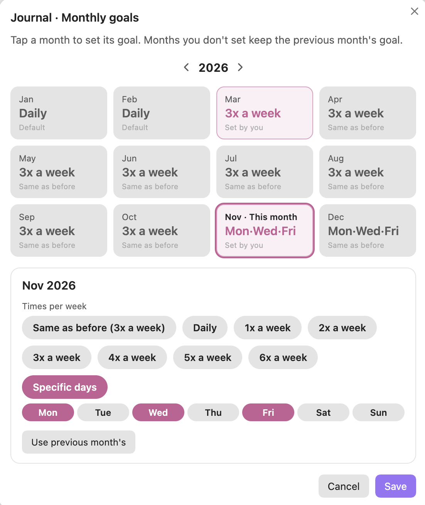
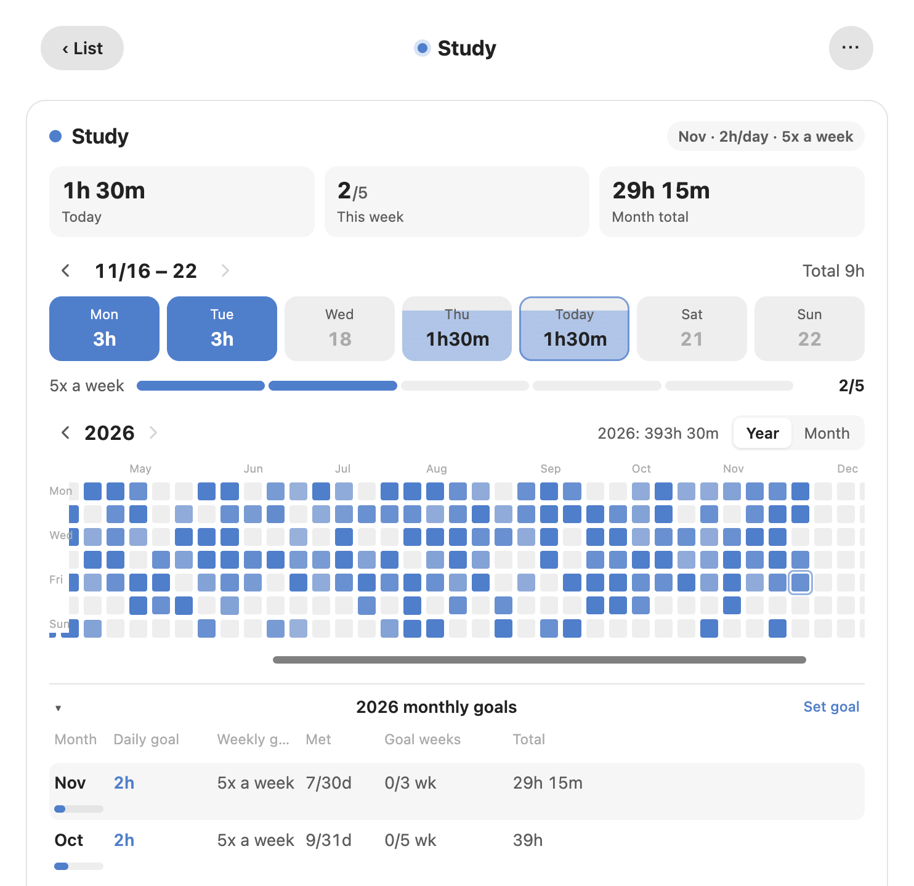
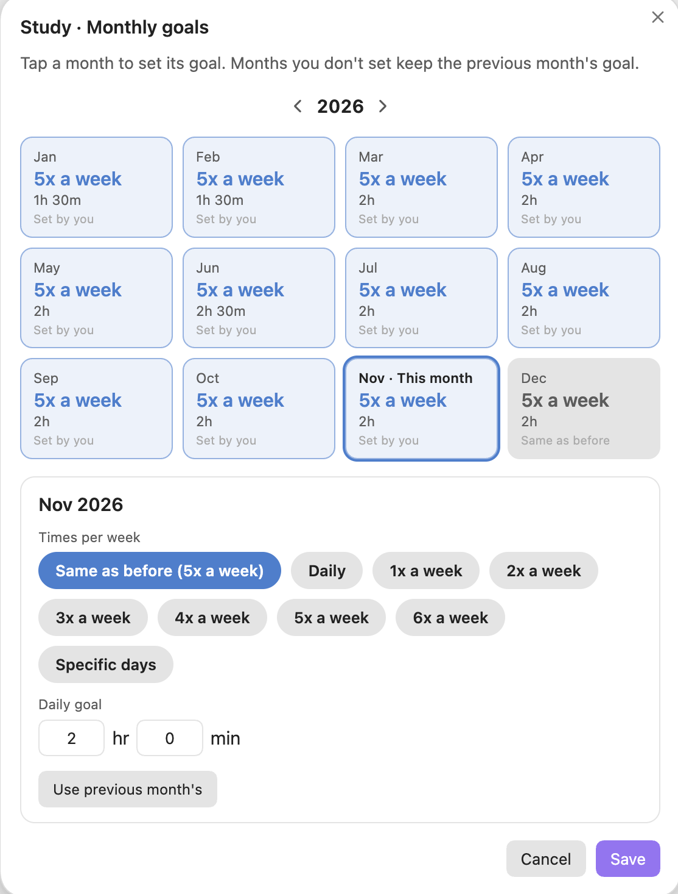
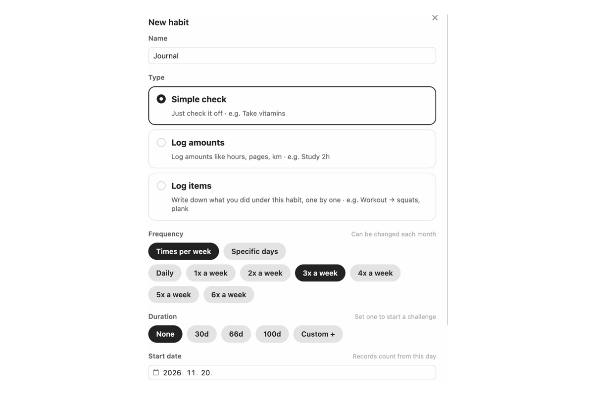
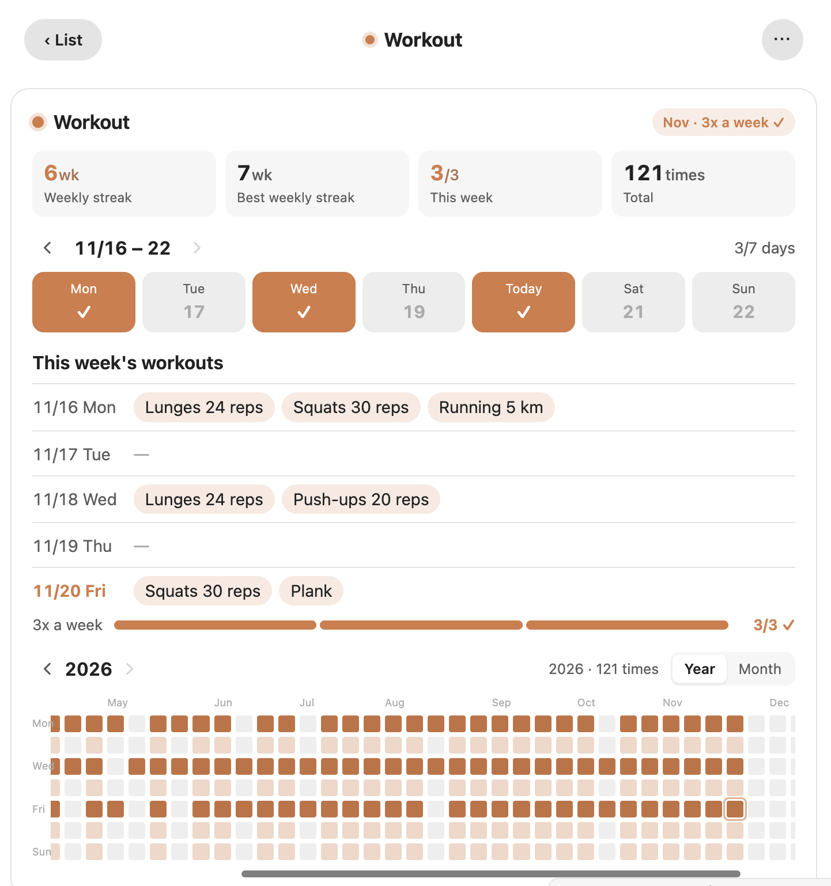
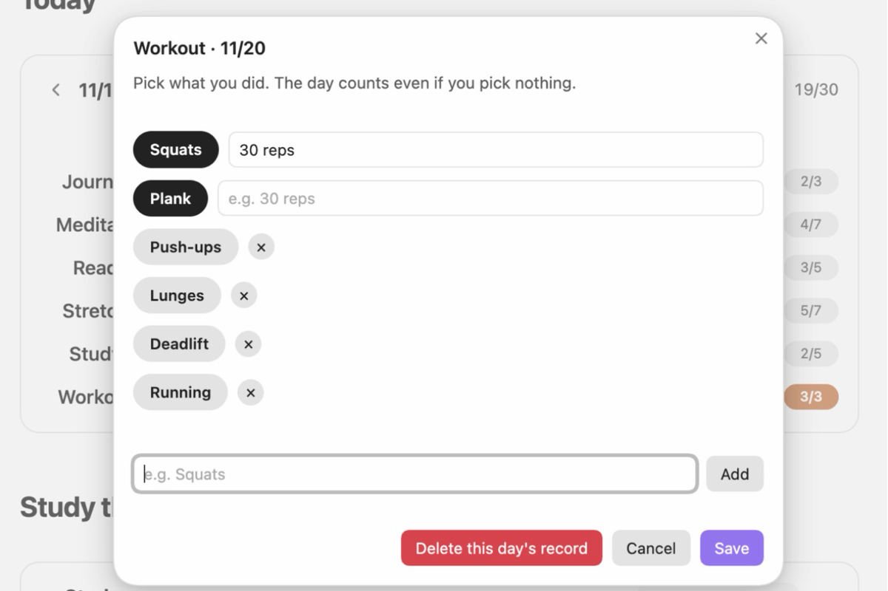

# Habit Grid

Turn habit records into a GitHub-style contribution grid inside your notes, with a week view, streaks, goals, and challenges.

> A Korean version of this document is available: [README.ko.md](https://github.com/yeongseo1225/obsidian-habit-grid/blob/main/README.ko.md).

**Quick setup for Apple Reminders:** [iPhone Shortcut](#iphone-shortcuts-integration-reminders) · [Mac sync](#optional-sync-from-a-mac). Pick **one** of the two (see below).

## Made for Apple Reminders, usable without it

Habit Grid was built to **log habits with Apple Reminders and visualize them in your vault**. Complete a reminder on your iPhone, let an iOS Shortcut append it to a Markdown file, and the dashboard shows it. See [iPhone Shortcuts integration](#iphone-shortcuts-integration-reminders) or, on a Mac, [Mac sync](#optional-sync-from-a-mac).

You don't need Reminders, though. Everything is stored in plain Markdown files, so you can also:

- create habits in the plugin and tap cells to log them,
- write the record lines by hand, or
- append lines with any other tool, such as another shortcut or a script.

The plugin only reads and writes Markdown files in your vault. It makes no network requests and sends no data anywhere. It is not affiliated with Apple.


## Features

- **Apple Reminders logging (optional)** – completed reminders from an iOS Shortcut are read from a Markdown log file.
- **Dashboard** – a `habit` code block (and a ready-made "Habits Dashboard" note) renders one card per habit with a year or half-year grid.
- **Three habit types**
  - *Simple check* – done or not done.
  - *Log amounts* – hours, minutes, pages, km, or any unit you type (e.g. "Study 2h").
  - *Log items* – one habit with named items underneath (e.g. Workout → squats, plank). See [Item habits](#item-habits).
- **Challenges** – give a habit a duration (30 / 66 / 100 days or custom) and it becomes a challenge card with progress, streak, and a "complete" banner. No duration means a regular card. Once a challenge reaches its weekly goal, the rest of that week is tinted like on regular cards. You can set how many times a week from the duration chip menu on the card.

  
- **Repeat rules** – "N times a week" or "specific days" (Mon, Wed, Fri…). Rules can differ per month; a month you leave empty keeps the previous month's rule.

  
- **Goals** – a daily amount goal per month for amount habits (e.g. 20 pages a day), plus how many weeks you hit your goal.

  

  
- **Edit by clicking** – click a cell to add or remove a record, or fill in past days from the log dialog.
- **Today row** – the top of the dashboard shows what to do today. Switch between *Day* (the last 14 days in a sideways-scrolling strip) and *Week* (one row per habit, one column per weekday; tap a cell to log that day, and page back through earlier weeks). Each row ends with done/goal for the week, using the times per week or weekdays you chose (every day if you set none); once the goal is met the remaining days switch to a light tint of the habit color. The choice is remembered. Use the `▾` button to fold the row down to its header; the state is remembered too.
- **Archive** – finished habits move to an archive folder; records are kept and can be restored.
- **Languages** – English, Korean, or automatic (follows the app language).
- **Your data stays in your notes** – no database, no network access.

## Installation

### From Community plugins

1. Open **Settings → Community plugins → Browse**.
2. Search for "Habit Grid", then install and enable it.

### Manual

1. Download `main.js`, `manifest.json` and `styles.css` from the [latest release](../../releases/latest).
2. Copy them into `<your vault>/.obsidian/plugins/habit-grid/`.
3. Reload the app and enable **Habit Grid** under **Settings → Community plugins**.

On first start the plugin creates the `habit-grid` folder, a `Habits Dashboard` note, and `sync/Reminders log.md`. The `list/` and `archive/` folders appear when you create or archive your first habit. You can also run **Create habits folder and dashboard** from the command palette.



## Commands

| Command | What it does |
| --- | --- |
| Open habits dashboard | Opens the dashboard note (ribbon icon too) |
| Insert day and week view | Inserts a `habit` block with `view: today` at the cursor |
| Create habits folder and dashboard | Creates the folder and note if missing |
| Create new habit | Opens the new-habit dialog |
| Log a habit (pick a date) | Opens the log dialog (ribbon icon too) |

## Folder structure

Everything lives under one folder (default `habit-grid`):

```
habit-grid/
├── Habits Dashboard.md      dashboard note
├── list/                    one file per habit, e.g. Study.md (settings and all records)
├── sync/                    inbox for Reminders: Reminders log.md
└── archive/                 archived habit files
```

Only these three subfolders are read; files placed directly in `habit-grid/` (other than the dashboard) are ignored.

**Where records live.** A habit's file in `list/` holds its settings and all of its records. `sync/Reminders log.md` is only an inbox for tools such as the Shortcut or the Mac script: whenever new lines arrive there, the plugin moves them into the habit files and creates the file of a habit it has not seen yet. To remove a day, clear it in the app (tap the cell, or use *Delete this day's record*). The plugin leaves a `- [ ] date` marker so the day is not imported again; if you delete the line by hand instead, a later Reminders line can bring the day back.

### Habit files

A habit file is a Markdown note in `habit-grid/list/`. The file name is the habit name. Settings live in the frontmatter, and manual records are lines in the body.

The plugin writes the property names below. Korean property names are also read (see the [Korean README](https://github.com/yeongseo1225/obsidian-habit-grid/blob/main/README.ko.md)); in settings, *Property names* chooses which style new properties are written in.

| Property | Meaning |
| --- | --- |
| `unit` | Unit for an amount habit: `hours`, `minutes`, `pages`, `km`, or any text |
| `monthGoals` | Daily goal per month: `"2026-11": 2` |
| `weeklyTimes` | Times per week, per month: `"2026-11": 3` |
| `weekdays` | Specific weekdays per month, `0` = Sunday … `6` = Saturday: `"2026-11": [1, 3, 5]` |
| `duration` | Challenge length in days |
| `start` | Start date, `YYYY-MM-DD`. Set when you create a habit; the week view shows the habit from this date, and a challenge counts from it. Without it, the first record is the start |
| `archived` | `true` when archived |
| `items` | `true` turns on item logging for the habit (see [Item habits](#item-habits)) |
| `hiddenItems` | Items removed from the suggestions of an items habit (past records are untouched) |
| `color` | Card color, e.g. `"#3b82f6"` |

Example:

```markdown
---
unit: hours
monthGoals:
  "2026-11": 2
weeklyTimes:
  "2026-11": 5
color: "#3b82f6"
---
- [x] 2026-11-18 1h30m
- [x] 2026-11-19 2h
```

The plugin writes these properties itself when you use its menus.

### Record lines

One record per line:

```
- [x] 2026-11-19 Stretching
```

That is a checked task, a date (`YYYY-MM-DD`), and the Reminders title. Rules:

- Identical lines (same date and same title) are counted once.
- Unchecked lines `- [ ] YYYY-MM-DD` in a habit file mark an imported day as removed.
- In an amount habit's file, a line can carry the amount after the date: `- [x] 2026-11-18 1h30m`. In an item habit's file, it lists the items: `- [x] 2026-11-20 squats 30 reps, plank`.

#### What a Reminders title becomes

| Reminder title | Result |
| --- | --- |
| `Meditate` | A simple check habit named *Meditate* |
| `Study 2h`, `Study 1h 30m`, `Study 45 min` | Hours logged for the habit *Study* (`h`, `hr`, `hours`, `m`, `min`, `minutes` work) |
| `Read 20 pages` | 20 pages for *Read* (`pages`) |
| `Run 5km` | 5 km for *Run* |
| `Workout Squats 30 reps` | The item *Squats* with *30 reps*, under the item habit *Workout* |
| `Workout 1h` | Counts the day for the item habit *Workout*; an amount right after the name is not an item, and is not kept |

Titles are matched with the habit name from the start of the title, and the match is case sensitive.

**Amount habits (hours, pages, km).** You can create the habit in the plugin (*New habit* → *Log amounts*) and tap a cell to enter the amount, or put the amount in the reminder title: `Study 2h`, `Study 2h 30m`, `Read 20 pages`. A habit named from a title is created automatically. Reminder titles do not change by themselves, so for amounts that differ every day, tapping a cell is easier. Use the same format every time: if some days are just `Study` and others `Study 2h`, the days without an amount are not shown. If two titles on one day have amounts, the larger one is used.

**Naming reminders that belong together.** For an item habit (a habit with item logging turned on, such as *Stretch* or *Workout*), a title that starts with its name becomes one of its items: write the habit name first and the part after it, like `Stretch Neck` or `Workout Legs`. For any other habit, or to keep a part as a habit of its own, write it the other way round, like `Neck Stretch`.

## Item habits

An item habit is a habit with things you did under it, like Workout → squats, plank. A habit is either an item habit or an amount habit (hours, pages, km), not both: if a habit has a unit, item logging is not available for it.

- **Turn it on** by creating a habit with the type *Log items*, by choosing **Turn on item logging** in a habit's `⋯` menu, or by adding `items: true` to the habit file. Reminder titles that start with that habit's name (`Workout Squats`) then become its items. Without this, `Workout Squats` is just another habit.
- **Log it**: tap a day to check it. Tap a checked day to pick what you did or add new items. Picking nothing still counts. Each item can carry an amount such as `30 reps`, and the amount field suggests the last one you used.
- **Suggestions** show items used in the last two months. The `×` next to a suggestion removes it from the list after you confirm; past records stay, and logging the item again brings it back.
- **Delete a day**: *Delete this day's record* in the dialog.

Items are stored on the day's line in the habit file, so you can also edit them by hand.






## iPhone Shortcuts integration (Reminders)

> **Use either this Shortcut or [Mac sync](#optional-sync-from-a-mac), not both.** Duplicate lines are counted once, but one method is simpler and easier to troubleshoot.

Habit logs can be collected from the Reminders app by an iOS Shortcut. It appends completed reminders from a list named **Habits** to `sync/Reminders log.md`.

### Quick install: download the shared Shortcut

1. Download and add the shortcut on your iPhone, iPad, or Mac: **[Reminders to Habit Grid](https://www.icloud.com/shortcuts/8e5699174e95444996780e637ebdce18)**. If iOS refuses, turn on **Allow Untrusted Shortcuts** in **Settings → Shortcuts**.
2. Everything is already set up. You only choose two things, because they are your own and are not shared with the shortcut:
   - **The Reminders list:** in **Find Reminders**, next to **List is**, pick the list whose habits you want to log (for example `Habits`).
   - **The file path:** in **both Append to File actions** (the one for reminders with a due date, and the one under *Otherwise*), set the folder to your vault's **`habit-grid/sync`** folder and keep the file name `Reminders log.md`. In the Files picker, your vault is under *iCloud Drive → Obsidian* or *On My iPhone → Obsidian*.
3. Run it once and open `Reminders log.md`. You should see one line per reminder, like `- [x] 2026-11-19 Meditate`.
4. Set it up the way you like:
   - **When it syncs:** in the Shortcuts app, go to **Automation → Personal Automation → Time of Day** and pick a time (for example every night at 11:55 PM). Turn on **Run Immediately** so no confirmation pops up. You can add several automations for different times, or run it when you open Obsidian. It cannot repeat every N minutes; for that, use [Mac sync](#optional-sync-from-a-mac).
   - **How many days it reads:** in **Find Reminders**, change *Completion Date is in the last 3 days* to any number of days. A bigger number catches reminders you complete late, but the log grows faster (see **Tidy log** below).

The log may collect the same line more than once, because the shortcut looks back three days on every run. That is fine: a habit is recorded only once per day. If the duplicates bother you, click **Tidy log** in the plugin settings to remove them.

The folder you pick for the shortcut is your own, so it is not included when the shortcut is shared. If a field is empty or points somewhere else, choose it yourself.

### Build the shortcut yourself

You can also build it yourself with the same actions, in order:

1. **Find Reminders** – List is `Habits`, Is Completed is `Yes`, Completion Date is in the last 3 days.
2. **Repeat with Each** item from step 1.
3. Inside the loop: **If** the reminder's **Due Date** **has any value**:
   - **Append to File** `habit-grid/sync/Reminders log.md` with the text `- [x] ` + the **Due Date** + a space + the **Repeat Item** (its title), with **Make New Line** on. Set the Due Date's date format to **Custom** `yyyy-MM-dd` (tap the Due Date variable to change it).
4. **Otherwise**:
   - **Append to File**, the same file and settings, with the text `- [x] ` + the **Completion Date** + a space + the **Repeat Item**. Set the Completion Date's format to **Custom** `yyyy-MM-dd` too. Then **End If** and **End Repeat**.

Name the shortcut anything you like, for example *Habit Grid log*.

**Use the Repeat Item variable for the title, not Reminders** (the whole list that *Find Reminders* returned). If you use the list, every line gets all the titles, and your records end up under the wrong habit. A correct log has one line per reminder, like this:

```
- [x] 2026-11-19 Meditate
- [x] 2026-11-20 Study 2h
```

Each reminder is logged under its **due date**, so yesterday's reminder that you check after midnight still counts for yesterday. A reminder without a due date is logged under the day you completed it. If you complete a reminder before its due day, it is logged on the due day.

Run it by hand or with a personal automation, for example every night at 11:55 PM. Because it looks back three days, a reminder you complete late is still picked up.

Looking back also means the shortcut appends the same lines again on every run. Your habit records are not duplicated (each day is counted once), but the log file keeps growing. Click **Tidy log** in the settings now and then to remove the duplicate lines. See *What a Reminders title becomes* above for how titles are read.

The plugin recognizes the log file by name. The default is `Reminders log`; you can set another name in settings. On first setup the plugin creates `habit-grid/sync/` and an empty `Reminders log.md` for the shortcut to append to.

## Optional: sync from a Mac

> **Use either this or the [iPhone Shortcut](#iphone-shortcuts-integration-reminders), not both.** Duplicate lines are counted once, but one method is simpler and easier to troubleshoot.

If you have a Mac, a small script can copy completed reminders into the log file instead of a Shortcut. Complete a reminder on any device; once it reaches your Mac through iCloud, the script appends it. If the Mac was off, it catches up the next time it runs (it reads the last 30 days).

Each reminder is logged under its **due date**, or under the day it was completed if it has none, the same as the Shortcut. A reminder for yesterday that you check after midnight still counts for yesterday.

This is an advanced option: you paste one command into Terminal, once. If you would rather not, tap cells to log habits, or use the Shortcut.

### Set up in 3 steps (macOS only)

1. In Obsidian, open **Settings → Habit Grid → Mac sync**, click **Create install files**, then click the command shown below it to select it all and copy it with Cmd+C.
2. Open Terminal (press ⌘ Space, type `Terminal`, press Return), paste the command with ⌘ V, and press Return. Allow access to Reminders if macOS asks.
3. Back in the settings, turn **Use Mac sync** on. It is off by default, so nothing runs until you do.

That is all. The default list is `Habits`; a new completed reminder in it shows up within the interval you choose below.

### Mac sync options

| Setting | What it does |
| --- | --- |
| Reminder lists to sync | The lists to read. Default `Habits`; separate several with commas and match the names in Reminders exactly |
| Days to read | How many past days to read each time (default 30). Use more if your Mac is often off |
| Sync interval | How often it imports: 5 minutes to 2 hours (default 30 minutes) |
| Sync now | Imports what is already in the log at once, and asks the script to run at its next wake-up (within 5 minutes) |

### What the install does

It copies the script to `~/.habit-grid-sync/` and sets up a background job that runs when you log in and wakes every 5 minutes; the script itself runs only when your chosen interval has passed. Nothing is downloaded. The files in your vault's `habit-grid/mac-sync/` folder are only used to install and to remove it (Obsidian's file list does not show `.sh` files, so use Finder or the **Show in Finder** button). The same files are in this repository's `scripts/` folder if you prefer to install without the plugin.

The script only reads Reminders and appends lines to the log file. Lines already in the file are skipped, so unlike the Shortcut it adds no duplicate lines.

### Remove it

Do this **before you uninstall the plugin**: in **Settings → Habit Grid → Mac sync**, click the remove command shown there to select it all, copy it with Cmd+C, paste it into Terminal, and press Return. (Uninstalling the plugin alone leaves the background job on your Mac; it does nothing without the plugin, but it keeps waking every 5 minutes.)

If you already uninstalled the plugin, paste these two lines into Terminal instead:

```bash
launchctl bootout "gui/$(id -u)/md.habitgrid.sync"
rm -rf ~/Library/LaunchAgents/md.habitgrid.sync.plist ~/.habit-grid-sync
```

## Dashboard code block

````
```habit
```
````

Optional lines inside the block: `habit: Study, Workout` (only these habits), `year: this` (see below), `weeks: 20`, `color: #3b82f6`, `folder: habit-grid`.

### Day and week view in your own notes

Put the day or week records anywhere, for example on a home note. Pick the code you want and paste it:

| Code | Shows |
| --- | --- |
| `view: today` | Day and week together, with a *Day / Week* switch (the choice is remembered and shared with the dashboard) |
| `view: day` | The day strip only |
| `view: week` | The week table only |

````
```habit
view: day
```
````

Replace `day` with `week` or `today` for the other views. Add `habit: Study, Workout` to show only some habits. The command **Insert day and week view** puts the `view: today` block at the cursor. Tapping works as on the dashboard, so you can log from the note. Each view has a **Today** / **This week** button that jumps back after you page through earlier days or weeks.

`view: day`:


`view: week`:


### One habit's year in your own notes

Name a habit and a year to show its year grid on a note, like the cards on the dashboard. Tap the card to open the full details:

````
```habit
habit: Study
year: this
```
````


| `year:` | Shows |
| --- | --- |
| `this` | The current year. It moves on by itself when the year changes, so you never edit the note |
| `2025` | That year, always |
| *(left out)* | The current year (or the last `weeks:` weeks, if you set it) |

The full details view has its own buttons to page between years.

## Disclosures

- **No network use.** The plugin makes no network requests and has no telemetry or ads.
- **Files stay in your vault.** The plugin reads and writes only Markdown files (and, when you click *Create install files*, two script files) inside your vault.
- **Optional Mac script.** If you choose to install it, it runs on your Mac outside Obsidian, reads your Apple Reminders lists, and appends lines to a log file inside your vault. The plugin never runs it; you start it yourself.

## Settings

| Setting | Description |
| --- | --- |
| Language | Auto (follows the app language), Korean, or English |
| Property names | Names written in habit files: auto, Korean, or English. Existing properties keep their names |
| Reminders log file name | Name of the log file the shortcut appends to (default `Reminders log`) |
| Habits folder | Folder that holds your habit files |
| Dashboard note name | Name of the dashboard note, with a "Create now" button |
| Main screen grid | 1 year or 6 months per page |
| Week starts on | Monday or Sunday |
| Cell color | Grid color; empty uses your theme accent |
| Click cells to add or remove records | Turn off to make the grid read-only |
| Tidy log | Removes duplicate lines from the Reminders log. Habit records are not changed |
| Mac sync | Settings for the optional Mac script: use it (off by default), the lists to read, days to read, interval, Sync now, and install and remove commands. See [Mac sync](#optional-sync-from-a-mac) |

Changes apply when a note is reopened.

## Limitations

- Reminder titles are parsed for the units `h`/`hours`, `m`/`min`/`minutes`, `pages`, `km`. Other units are not recognized in a title; use an amount habit's file instead.
- Item names cannot contain commas.
- The item dialog opens from the day and week views, not from the year grid cards.
- Amount habits cannot have a challenge duration yet.
- Only the Reminders → Markdown direction is supported; editing a reminder does not change old records.
- Days are counted in the device's local time zone.
- The plugin moves a habit file between `list` and `archive` when you archive or restore it.

## Development

The source lives in `src/` and is bundled into `main.js` with esbuild. Edit `src/`, not `main.js`.

```bash
npm install
npm run dev     # rebuild main.js on every save (works with the Hot Reload plugin)
npm run build   # one-off production build
npm run lint    # eslint
npm test        # node tests for the pure logic
```

## License

[MIT](LICENSE)
