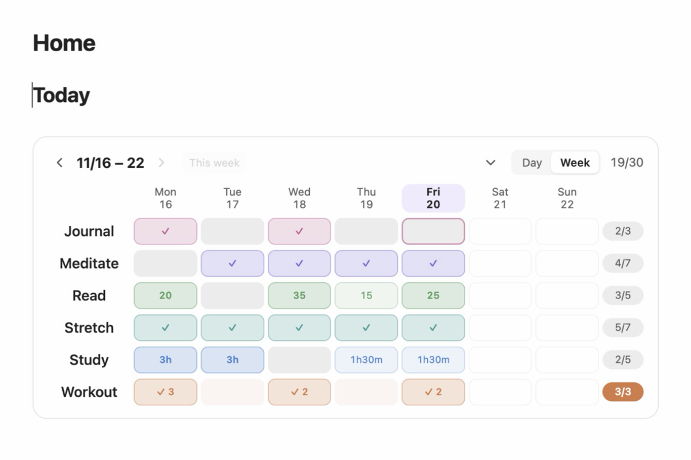
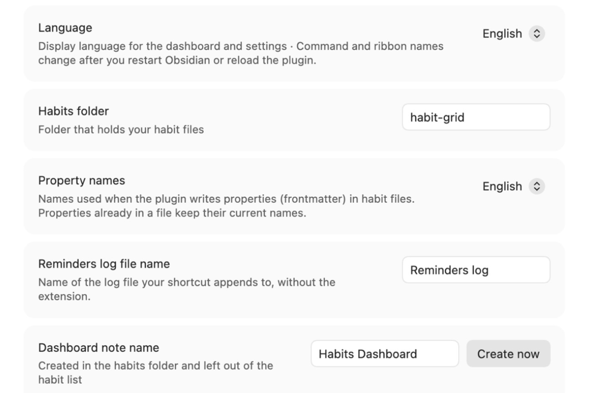

# Habit Grid

Turn habit records into a GitHub-style contribution grid inside your notes, with a week view, streaks, goals, and challenges.

> 한국어 설명은 [아래](#한국어)에 있어요.

## Made for Apple Reminders, usable without it

Habit Grid was built to **log habits with Apple Reminders and visualize them in your vault**. Complete a reminder on your iPhone, let an iOS Shortcut append it to a Markdown file, and the dashboard shows it. See [iPhone Shortcuts integration](#iphone-shortcuts-integration-reminders).

You don't need Reminders, though. Everything is stored in plain Markdown files, so you can also:

- create habits in the plugin and tap cells to log them,
- write the record lines by hand, or
- append lines with any other tool, such as another shortcut or a script.

The plugin only reads and writes Markdown files in your vault. It makes no network requests and sends no data anywhere. It is not affiliated with Apple.


## Features

- **Apple Reminders logging (optional)** – completed reminders from an iOS Shortcut are read from a Markdown log file.
- **Dashboard** – a `habit` code block (and a ready-made "Habits Dashboard" note) renders one card per habit with a year or half-year grid.
- **Three habit types**
  - *Simple check* – done or not done.
  - *Log amounts* – hours, minutes, pages, km, or any unit you type (e.g. "Study 2h").
  - *Log items* – one habit with named items underneath (e.g. Workout → squats, plank). See [Item habits](#item-habits).
- **Challenges** – give a habit a duration (30 / 66 / 100 days or custom) and it becomes a challenge card with progress, streak, and a "complete" banner. No duration means a regular card.

  
- **Repeat rules** – "N times a week" or "specific days" (Mon, Wed, Fri…). Rules can differ per month; a month you leave empty keeps the previous month's rule.
- **Goals** – a daily goal per month for amount habits, plus goal-week statistics.

  

  
- **Edit by clicking** – click a cell to add or remove a record, or fill in past days from the log dialog.
- **Today row** – the top of the dashboard shows what to do today. Switch between *Day* (the last 14 days in a sideways-scrolling strip) and *Week* (one row per habit, one column per weekday; tap a cell to log that day, and page back through earlier weeks). Each row ends with done/goal for the week, using the times per week or weekdays you chose (every day if you set none); once the goal is met the remaining days switch to a light tint of the habit color. The choice is remembered. Use the `▾` button to fold the row down to its header; the state is remembered too.
- **Archive** – finished habits move to an archive folder; records are kept and can be restored.
- **Languages** – English, Korean, or automatic (follows the app language).
- **Your data stays in your notes** – no database, no network access.

## Installation

### From Community plugins (after approval)

1. Open **Settings → Community plugins → Browse**.
2. Search for "Habit Grid", then install and enable it.

### Manual

1. Download `main.js`, `manifest.json` and `styles.css` from the [latest release](../../releases/latest).
2. Copy them into `<your vault>/.obsidian/plugins/habit-grid/`.
3. Reload the app and enable **Habit Grid** under **Settings → Community plugins**.

On first start the plugin creates the `habit-grid` folder, a `Habits Dashboard` note, and `sync/Reminders log.md`. The `list/` and `archive/` folders appear when you create or archive your first habit. You can also run **Create habits folder and dashboard** from the command palette.


## Commands

| Command | What it does |
| --- | --- |
| Open habits dashboard | Opens the dashboard note (ribbon icon too) |
| Insert day and week view | Inserts a `habit` block with `view: today` at the cursor |
| Create habits folder and dashboard | Creates the folder and note if missing |
| Create new habit | Opens the new-habit dialog |
| Log a habit (pick a date) | Opens the log dialog (ribbon icon too) |

## Folder structure

Everything lives under one folder (default `habit-grid`):

```
habit-grid/
├── Habits Dashboard.md      dashboard note
├── list/                    one file per habit, e.g. Study.md (settings and all records)
├── sync/                    inbox for Reminders: Reminders log.md
└── archive/                 archived habit files
```

Only these three subfolders are read; files placed directly in `habit-grid/` (other than the dashboard) are ignored.

**Where records live.** A habit's file in `list/` holds its settings and all of its records. `sync/Reminders log.md` is only an inbox for tools such as the Shortcut or the Mac script: whenever new lines arrive there, the plugin moves them into the habit files and creates the file of a habit it has not seen yet. To remove a day, clear it in the app (tap the cell, or use *Delete this day's record*). The plugin leaves a `- [ ] date` marker so the day is not imported again; if you delete the line by hand instead, a later Reminders line can bring the day back.

### Habit files

A habit file is a Markdown note in `habit-grid/list/`. The file name is the habit name. Settings live in the frontmatter, and manual records are lines in the body.

Every property has a Korean name and an English name. Both are always read; the plugin writes whichever style the file already uses, or the style you pick in settings (see *Property names*).

| English name | Korean name | Meaning |
| --- | --- | --- |
| `unit` | `단위` | Unit for an amount habit: `hours`, `minutes`, `pages`, `km`, or any text (Korean `시간`, `분`, `쪽` also work) |
| `monthGoals` | `월별목표` | Daily goal per month: `"2026-11": 2` |
| `weeklyTimes` | `월별횟수` | Times per week, per month: `"2026-11": 3` |
| `weekdays` | `월별요일` | Specific weekdays per month, `0` = Sunday … `6` = Saturday: `"2026-11": [1, 3, 5]` |
| `duration` | `기간` | Challenge length in days |
| `start` | `시작` | Start date, `YYYY-MM-DD`. Set when you create a habit; the week view shows the habit from this date, and a challenge counts from it. Without it, the first record is the start |
| `archived` | `보관` | `true` when archived |
| `items` | `항목` | `true` turns on item logging for the habit (see [Item habits](#item-habits)) |
| `hiddenItems` | `숨긴항목` | Items removed from the suggestions of an items habit (past records are untouched) |
| `color` | `색` | Card color, e.g. `"#3b82f6"` |

Example:

```markdown
---
unit: hours
monthGoals:
  "2026-11": 2
weeklyTimes:
  "2026-11": 5
color: "#3b82f6"
---
- [x] 2026-11-18 1h30m
- [x] 2026-11-19 2h
```

The plugin writes these properties itself when you use its menus.

### Record lines

One record per line:

```
- [x] 2026-11-19 Stretching
```

That is a checked task, a date (`YYYY-MM-DD`), and the Reminders title. Rules:

- Identical lines (same date and same title) are counted once.
- Unchecked lines `- [ ] YYYY-MM-DD` in a habit file mark an imported day as removed.
- In an amount habit's file, a line can carry the amount after the date: `- [x] 2026-11-18 1h30m`. In an item habit's file, it lists the items: `- [x] 2026-11-20 squats 30 reps, plank`.

#### What a Reminders title becomes

| Reminder title | Result |
| --- | --- |
| `Meditate` | A simple check habit named *Meditate* |
| `Study 2h`, `Study 1h 30m`, `Study 45 min` | Hours logged for the habit *Study* (`h`, `hr`, `hours`, `m`, `min`, `minutes` and the Korean `시간`, `분` work) |
| `Read 20 pages` | 20 pages for *Read* (`pages`, `쪽`, `페이지`) |
| `Run 5km` | 5 km for *Run* |
| `Workout Squats 30 reps` | The item *Squats* with *30 reps*, under the item habit *Workout* |
| `Workout 1h` | Counts the day for the item habit *Workout*; an amount right after the name is not an item, and is not kept |
| `운동 스쿼트 30회` | The same in Korean: the item *스쿼트* with *30회* under the item habit *운동* |

Titles are matched with the habit name from the start of the title, and the match is case sensitive.

**Amount habits (hours, pages, km).** You can create the habit in the plugin (*New habit* → *Log amounts*) and tap a cell to enter the amount, or put the amount in the reminder title: `Study 2h`, `Study 2h 30m`, `Read 20 pages`. A habit named from a title is created automatically. Reminder titles do not change by themselves, so for amounts that differ every day, tapping a cell is easier. Use the same format every time: if some days are just `Study` and others `Study 2h`, the days without an amount are not shown. If two titles on one day have amounts, the larger one is used.

**Naming reminders that belong together.** For an item habit (a habit with item logging turned on, such as *Stretch* or *Workout*), a title that starts with its name becomes one of its items: write the habit name first and the part after it, like `Stretch Neck` or `Workout Legs`. For any other habit, or to keep a part as a habit of its own, write it the other way round, like `Neck Stretch`.

## Item habits

An item habit is a habit with things you did under it, like Workout → squats, plank. A habit is either an item habit or an amount habit (hours, pages, km), not both: if a habit has a unit, item logging is not available for it.

- **Turn it on** by creating a habit with the type *Log items*, by choosing **Turn on item logging** in a habit's `⋯` menu, or by adding `items: true` to the habit file. Reminder titles that start with that habit's name (`Workout Squats`) then become its items. Without this, `Workout Squats` is just another habit.
- **Log it**: tap a day to check it. Tap a checked day to pick what you did or add new items. Picking nothing still counts. Each item can carry an amount such as `30 reps`, and the amount field suggests the last one you used.
- **Suggestions** show items used in the last two months. The `×` next to a suggestion removes it from the list after you confirm; past records stay, and logging the item again brings it back.
- **Delete a day**: *Delete this day's record* in the dialog.

Items are stored on the day's line in the habit file, so you can also edit them by hand.


## iPhone Shortcuts integration (Reminders)

Habit logs can be collected from the Reminders app by an iOS Shortcut. It appends completed reminders from a list named **Habits** to `sync/Reminders log.md`.

Build the shortcut with these actions, in order:

1. **Find Reminders** – List is `Habits`, Is Completed is `Yes`, Completion Date is in the last 7 days.
2. **Repeat with Each** item from step 1.
3. Inside the loop: **Format Date** – the item's Completion Date, custom format `yyyy-MM-dd`.
4. Inside the loop: **Text** – `- [x] ` + the formatted date + a space + the reminder's Title.
5. After the loop: **Combine Text** – the repeat results, separated by **New Lines**.
6. **Append to File** – the combined text, to `habit-grid/sync/Reminders log.md` in your vault (create the file first if needed).

Run it by hand or with a personal automation. Because the shortcut looks back seven days, the same line can be appended more than once; duplicates are counted once. See *What a Reminders title becomes* above for how titles are read.

The plugin recognizes the log file by name. The default is `Reminders log`; you can set another name in settings. On first setup the plugin creates `habit-grid/sync/` and an empty `Reminders log.md` for the shortcut to append to.

### Optional: sync from a Mac

If you have a Mac, a small script can copy completed reminders into the log file instead of a Shortcut. Complete a reminder on any device; once it reaches your Mac through iCloud, the script appends it. If the Mac was off, it catches up the next time it runs (it reads the last 30 days).

Set it up from the plugin settings (macOS only):

1. In Obsidian, open **Settings → Habit Grid → Mac sync** and click **Create install files**. The plugin writes two files into `habit-grid/mac-sync/` in your vault and shows a command.
2. Click **Copy command**, paste it into Terminal, and press Return. It copies the script to `~/.habit-grid-sync/`, sets up a background job that wakes every 5 minutes, and runs one sync so macOS can ask for access to Reminders. Allow it.
3. Back in the settings, turn **Use Mac sync** on (it is off by default, so nothing runs until you do) and set **Reminder lists to sync** (default `Habits`; separate several lists with commas, matching the names in Reminders exactly). **Days to read** and **Sync interval** control how far back and how often it runs, and **Sync now** imports what is in the log immediately and asks the script to run at its next wake-up (within 5 minutes).
4. To remove it, run `bash "<vault>/habit-grid/mac-sync/install-mac-sync.sh" --uninstall`.

The same files are in this repository's `scripts/` folder if you prefer to install without the plugin. Nothing is downloaded during installation.

The script only reads Reminders and appends lines to the log file. Lines already in the file are skipped.

## Dashboard code block

````
```habit
```
````

Optional lines inside the block: `habit: Study, Workout` (only these habits), `year: this` (see below), `weeks: 20`, `color: #3b82f6`, `folder: habit-grid`.

### Day and week view in your own notes

Put the day or week records anywhere, for example on a home note. Pick the code you want and paste it:

| Code | Shows |
| --- | --- |
| `view: today` | Day and week together, with a *Day / Week* switch (the choice is remembered and shared with the dashboard) |
| `view: day` | The day strip only |
| `view: week` | The week table only |

````
```habit
view: day
```
````

Replace `day` with `week` or `today` for the other views. Add `habit: Study, Workout` to show only some habits. The command **Insert day and week view** puts the `view: today` block at the cursor. Tapping works as on the dashboard, so you can log from the note. Each view has a **Today** / **This week** button that jumps back after you page through earlier days or weeks.



### One habit's year in your own notes

Name a habit and a year to show its year grid on a note:

````
```habit
habit: Study
year: this
```
````

| `year:` | Shows |
| --- | --- |
| `this` | The current year. It moves on by itself when the year changes, so you never edit the note |
| `2025` | That year, always |
| *(left out)* | The current year, with buttons to page between years |

With `year:` set, the year buttons are hidden.

## Disclosures

- **No network use.** The plugin makes no network requests and has no telemetry or ads.
- **Files stay in your vault.** The plugin reads and writes only Markdown files (and, when you click *Create install files*, two script files) inside your vault.
- **Optional Mac script.** If you choose to install it, it runs on your Mac outside Obsidian, reads your Apple Reminders lists, and appends lines to a log file inside your vault. The plugin never runs it; you start it yourself.

## Settings

| Setting | Description |
| --- | --- |
| Language | Auto (follows the app language), Korean, or English |
| Property names | Names written in habit files: auto, Korean, or English. Existing properties keep their names |
| Reminders log file name | Name of the log file the shortcut appends to (default `Reminders log`) |
| Habits folder | Folder that holds your habit files |
| Dashboard note name | Name of the dashboard note, with a "Create now" button |
| Main screen grid | 1 year or 6 months per page |
| Week starts on | Monday or Sunday |
| Cell color | Grid color; empty uses your theme accent |
| Click cells to add or remove records | Turn off to make the grid read-only |

Changes apply when a note is reopened.



## Limitations

- Reminder titles are parsed for the units `h`/`hours`, `m`/`min`/`minutes`, `pages`, `km` and the Korean `시간`, `분`, `회`, `쪽`, `페이지`. Other units are not recognized in a title; use an amount habit's file instead.
- Item names cannot contain commas, and items from Reminders can't be removed in the item dialog.
- The item dialog opens from the day and week views, not from the year grid cards.
- Amount habits cannot have a challenge duration yet.
- Only the Reminders → Markdown direction is supported; editing a reminder does not change old records.
- Days are counted in the device's local time zone.
- The plugin moves a habit file between `list` and `archive` when you archive or restore it, and tidies already-archived habits at startup.

## Development

The source lives in `src/` and is bundled into `main.js` with esbuild. Edit `src/`, not `main.js`.

```bash
npm install
npm run dev     # rebuild main.js on every save (works with the Hot Reload plugin)
npm run build   # one-off production build
npm run lint    # eslint
npm test        # node tests for the pure logic
```

## License

[MIT](LICENSE)

---

# 한국어

Habit Grid는 습관 기록을 GitHub 잔디 같은 격자로 보여주는 플러그인이에요. 주간 보기, 연속 기록, 목표, 챌린지를 지원해요.

## 애플 미리 알림을 위해 만들었지만, 없이도 쓸 수 있어요

Habit Grid는 **애플 미리 알림으로 습관을 기록하고 보관함에서 시각화**하려고 만들었어요. iPhone에서 미리 알림을 완료하면 iOS 단축어가 그 기록을 마크다운 파일에 덧붙이고, 대시보드에 바로 보여요. [단축어 연동](#단축어-연동)을 보세요.

미리 알림이 없어도 괜찮아요. 모든 기록이 평범한 마크다운 파일이라서 이렇게도 쓸 수 있어요.

- 플러그인에서 습관을 만들고 칸을 눌러 기록해요.
- 기록 줄을 직접 적어요.
- 다른 단축어나 스크립트 같은 도구로 줄을 덧붙여요.

플러그인은 보관함의 마크다운 파일만 읽고 쓰고, 네트워크를 쓰거나 데이터를 밖으로 보내지 않아요. 애플과는 관련이 없어요.

## 기능

- **대시보드**: `habit` 코드 블록과 "Habits Dashboard" 노트로 습관 카드와 연간 격자를 보여줘요.
- **습관 종류**: 기본(체크), 양 기록(시간·쪽·km 등), 항목 기록(운동 → 스쿼트, 플랭크). 양 기록과 항목 기록은 한 습관에서 함께 쓰지 않아요.
- **챌린지**: 기간(30/66/100일 등)을 정하면 챌린지 카드, 없으면 일반 카드예요.
- **반복 규칙**: 주 N회 또는 요일 지정. 달마다 따로 정할 수 있고 비워 둔 달은 앞 달 값을 이어 써요.
- **목표**: 양 기록의 월별 하루 목표와 달성 주 통계.
- **오늘 줄**: 일간(최근 14일)과 주간(습관별 요일 표) 중에 골라요. 주간 표는 줄마다 `달성/목표`가 보이고, 목표를 채우면 남은 칸이 습관 색의 연한 톤으로 바뀌어요. 선택은 기억해요.
- **칸을 눌러 기록**하고, 지난 기록은 "지난 기록 채우기"로 채워요.
- **보관함**: 끝낸 습관은 보관함으로 옮겨요. 기록은 남아요.
- **한국어·영어·자동**을 지원해요.

## 설치

공식 목록에서 "Habit Grid"를 검색해 설치하거나(승인 후), GitHub 릴리스의 `main.js`, `manifest.json`, `styles.css`를 `<보관함>/.obsidian/plugins/habit-grid/`에 복사하고 플러그인을 켜요. 처음 켜면 `habit-grid` 폴더와 `Habits Dashboard` 노트를 만들어요.

## 폴더와 파일

`habit-grid/` 아래에 `Habits Dashboard.md`, `list/`(습관 파일), `sync/`(`Reminders log.md` 미리 알림 받은편지함), `archive/`(보관한 습관)가 있어요. 이 세 하위 폴더만 읽어요.

**기록이 있는 곳.** `list/`의 습관 파일 하나가 그 습관의 설정과 모든 기록을 담아요. `sync/Reminders log.md`는 단축어나 Mac 스크립트 같은 도구가 덧붙이는 받은편지함일 뿐이에요. 새 줄이 들어오면 플러그인이 습관 파일로 옮기고, 처음 보는 습관이면 파일을 만들어요. 기록은 앱에서 지우세요(칸을 누르거나 '이날 기록 지우기'). 지운 날에 `- [ ] 날짜` 표시를 남겨서 다시 가져오지 않아요. 파일에서 손으로 줄을 지우면 이후 미리 알림 줄이 그 날을 다시 살릴 수 있어요.

습관 파일의 속성은 한국어 이름과 영어 이름을 둘 다 읽어요.

| 한국어 | 영어 | 뜻 |
| --- | --- | --- |
| `단위` | `unit` | 양 습관의 단위 (`시간`, `분`, `쪽`, `km` 또는 아무 글자) |
| `월별목표` | `monthGoals` | 달마다 하루 목표 |
| `월별횟수` | `weeklyTimes` | 달마다 주 몇 회 |
| `월별요일` | `weekdays` | 달마다 요일 (0=일 … 6=토) |
| `기간` | `duration` | 챌린지 일수 |
| `시작` | `start` | 시작일 (`YYYY-MM-DD`) |
| `보관` | `archived` | 보관했으면 `true` |
| `항목` | `items` | `true`면 항목 습관 |
| `숨긴항목` | `hiddenItems` | 추천에서 뺀 항목 |
| `색` | `color` | 카드 색 |

기록은 한 줄에 하나예요: `- [x] 2026-11-19 스트레칭`. 같은 날짜·같은 제목의 중복 줄은 한 번만 세요. 습관 파일에서는 양 습관이면 `- [x] 2026-11-18 1h30m`, 항목 습관이면 `- [x] 2026-11-20 스쿼트 30회, 플랭크`처럼 적어요.

### 미리 알림 제목은 이렇게 읽어요

| 미리 알림 제목 | 결과 |
| --- | --- |
| `스트레칭` | 체크 습관 "스트레칭" |
| `공부 2시간`, `공부 1h 30m` | 습관 "공부"의 시간 |
| `독서 20쪽`, `달리기 5km` | 쪽, km 양 |
| `운동 스쿼트 30회` | 항목 습관 "운동"의 항목 "스쿼트 30회" |
| `운동 1h` | 항목 습관에서는 그 날만 한 날로 세요(시간은 안 남아요) |

제목 앞부분이 습관 이름과 같아야 하고, 대소문자를 구분해요.

**양 습관(시간·쪽·km).** 플러그인에서 *새 습관* → *양 기록*으로 만들고 칸을 눌러 양을 입력하거나, 미리 알림 제목에 양을 적어요: `공부 2시간`, `공부 2시간 30분`, `독서 20쪽`. 제목으로 만든 습관은 자동으로 생겨요. 미리 알림 제목은 저절로 바뀌지 않아서, 날마다 양이 다르면 칸을 눌러 입력하는 편이 쉬워요. 항상 같은 형식으로 쓰세요. 어떤 날은 `공부`, 어떤 날은 `공부 2시간`이면 양이 없는 날은 보이지 않아요. 같은 날 양이 있는 제목이 둘이면 큰 값을 써요.

**함께 묶일 미리 알림 이름 짓기.** 항목 기록을 켠 습관(예: *스트레칭*, *운동*)은 그 이름으로 시작하는 제목이 그 습관의 항목이 돼요. 습관 이름을 앞에, 부위를 뒤에 써요: `스트레칭 목`, `운동 하체`. 항목 기록을 켜지 않은 습관이거나 따로 하나의 습관으로 두고 싶으면 순서를 바꿔 `목 스트레칭`처럼 써요.

## 항목 습관

운동 → 스쿼트, 플랭크처럼 습관 아래에 한 것을 남기는 습관이에요.

- **켜는 법**: 새 습관에서 "항목 기록"을 고르거나, 카드 `⋯` 메뉴의 "항목 기록 켜기"를 누르거나, 습관 파일에 `항목: true`를 적어요. 켜면 그 습관 이름으로 시작하는 미리 알림(`운동 스쿼트`)이 항목이 돼요. 습관을 먼저 만들어야 해요.
- **기록**: 빈 칸을 누르면 체크돼요. 체크한 칸을 다시 누르면 한 항목을 고르거나 새로 적어요. 하나도 안 골라도 그 날은 기록돼요. 항목마다 `30회` 같은 양을 적을 수 있어요.
- **추천**은 최근 두 달 안에 쓴 항목이에요. `×`로 빼면 확인을 한 번 더 묻고, 지난 기록은 그대로예요.
- **`이날 기록 지우기`**로 그날 기록을 지워요.

## 단축어 연동

미리 알림의 `Habits` 목록에서 완료한 항목을 `sync/Reminders log.md` 끝에 덧붙이는 iOS 단축어를 만들어요.

1. **미리 알림 찾기** – 목록 = Habits, 완료됨 = 예, 완료일이 최근 7일 이내
2. **각 항목 반복**
3. 반복 안에서 **날짜 서식** – 완료일, 사용자 지정 `yyyy-MM-dd`
4. 반복 안에서 **텍스트** – `- [x] 날짜 제목`
5. 반복이 끝난 뒤 **텍스트 결합** – 구분자는 새 줄
6. **파일에 추가** – `habit-grid/sync/Reminders log.md`

7일치를 다시 읽기 때문에 같은 줄이 여러 번 붙을 수 있지만, 중복은 한 번만 세요. 처음 설정할 때 `sync/` 폴더와 빈 `Reminders log.md`를 자동으로 만들어요.

### 선택: Mac에서 자동으로 가져오기

Mac이 있다면 단축어 대신 작은 스크립트가 완료한 미리 알림을 로그 파일에 덧붙일 수 있어요. 어느 기기에서 완료하든 iCloud로 Mac에 도착하면 스크립트가 덧붙이고, Mac이 꺼져 있었다면 켜진 뒤 다음 실행 때 따라잡아요(최근 30일을 읽어요).

플러그인 설정에서 설치해요(macOS 전용).

1. 옵시디언 **설정 → Habit Grid → Mac 동기화**에서 **설치 파일 만들기**를 눌러요. 볼트의 `habit-grid/mac-sync/`에 파일 두 개가 만들어지고 명령이 나와요.
2. **명령 복사**를 누르고 터미널에 붙여 넣어 실행해요. 스크립트를 `~/.habit-grid-sync/`에 복사하고, 5분마다 깨어나는 백그라운드 작업을 등록하고, 한 번 실행해서 macOS가 미리 알림 접근을 물어보게 해요. 허용하세요.
3. 설정으로 돌아와 **Mac 동기화 사용**을 켜요(기본은 꺼짐이라 켜기 전에는 아무것도 하지 않아요). **동기화할 미리 알림 목록**에 목록 이름을 적어요(기본 `Habits`, 여러 개는 쉼표로, 미리 알림 앱의 이름과 똑같이). **가져올 기간**과 **동기화 간격**으로 얼마나 거슬러 읽고 얼마나 자주 돌릴지 정하고, **지금 동기화**는 로그에 있는 내용을 바로 가져오면서 스크립트에 다음 확인 때(5분 이내) 실행하라고 요청해요.
4. 지우려면 `bash "<보관함>/habit-grid/mac-sync/install-mac-sync.sh" --uninstall`을 실행해요.

플러그인 없이 설치하고 싶으면 이 저장소의 `scripts/` 폴더에 같은 파일이 있어요. 설치 중에는 아무것도 내려받지 않아요.

스크립트는 미리 알림을 읽기만 하고 로그 파일에 줄을 덧붙이기만 해요. 이미 있는 줄은 건너뛰어요.

## 노트에 일간·주간 기록 넣기

홈 노트 같은 곳에 원하는 코드를 붙여 넣어요.

| 코드 | 보여주는 것 |
| --- | --- |
| `view: today` | 일간·주간을 한 번에, *일간 / 주간* 전환 버튼 포함 (고른 쪽은 기억하고 대시보드와 같이 써요) |
| `view: day` | 일간만 |
| `view: week` | 주간만 |

````
```habit
view: day
```
````

`day`를 `week`나 `today`로 바꾸면 다른 보기가 돼요. `habit: 공부, 운동`을 더하면 일부 습관만 보여줘요. 명령 "일간·주간 기록 코드 넣기"가 커서 위치에 `view: today`를 넣어 줘요. 지난 날이나 주로 넘겨 본 뒤에는 **오늘** / **이번 주** 버튼으로 바로 돌아와요.

## 노트에 습관 하나의 한 해 넣기

습관 이름과 연도를 적으면 그 습관의 연간 격자를 보여줘요.

````
```habit
습관: 공부
연도: 올해
```
````

| `연도:` | 보여주는 것 |
| --- | --- |
| `올해` (또는 `this`) | 올해. 해가 바뀌면 저절로 넘어가서 노트를 고칠 필요가 없어요 |
| `2025` | 그 해로 고정 |
| (생략) | 올해, 그리고 해를 넘기는 버튼 |

`연도`를 적으면 해 넘기기 버튼은 숨겨요.

## 공개 사항

- **네트워크를 쓰지 않아요.** 네트워크 요청, 텔레메트리, 광고가 없어요.
- **파일은 볼트 안에서만** 읽고 써요. 마크다운 파일만 다루고, *설치 파일 만들기*를 눌렀을 때만 스크립트 파일 두 개를 볼트에 만들어요.
- **선택 사항인 Mac 스크립트**: 설치하기로 하면 옵시디언 밖에서 Mac에서 돌며 미리 알림 목록을 읽고 볼트 안의 로그 파일에 줄을 덧붙여요. 플러그인은 이 스크립트를 실행하지 않아요. 사용자가 직접 시작해요.

## 설정

언어, 속성 이름(한국어/영어), 미리 알림 기록 파일 이름, 습관 폴더, 대시보드 노트 이름, 메인 격자(1년/6개월), 한 주의 시작, 칸 색깔, 칸을 눌러 기록 고치기가 있어요.
